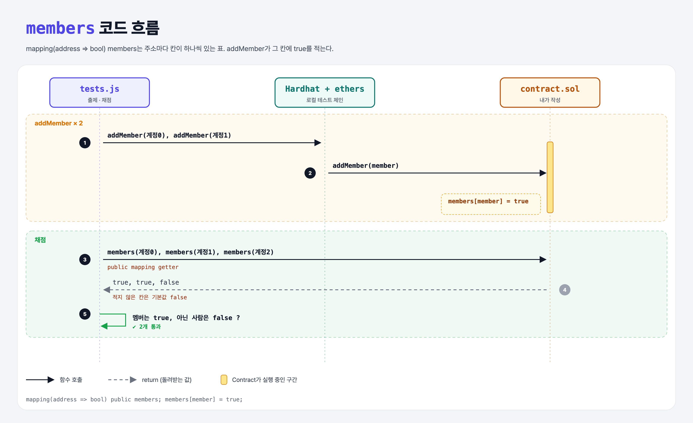

# Members Mapping (Mappings 1단계)

## 문제

1. 주소를 bool로 대응시키는 public mapping `members`를 만든다 (멤버인지 여부).
2. 주소를 받아 멤버로 등록하는 external 함수 `addMember`를 만든다.

## 한 줄 요약

`mapping(address => bool) public members;` + `members[member] = true;` — mapping은 Solidity의 딕셔너리(해시 테이블)다.



### 다이어그램 읽는 법

| 구간 | 일어나는 일 |
|------|-------------|
| addMember × 2 | 계정 0, 1의 칸에 true를 적음 |
| 채점 | 계정 0, 1은 true, 계정 2는 아무것도 안 적어서 기본값 false |

---

## 0. 이 과제가 말하려는 것

> **mapping = 키로 값을 바로 찾는 표 (O(1)). 주소별 기록을 남길 때 가장 많이 쓰는 자료구조다.**

```
[members 만들기] → 멤버 확인 → 멤버 삭제 → 구조체 저장 → 잔액 송금 → 중첩 mapping
 ★ 이 단계        is-member   remove-member  mapping-structs  transfer-amount  nested-mappings
```

- ERC-20 토큰의 잔액도 `mapping(address => uint) public balanceOf;`로 관리한다 (DAI, USDC 등).
- Python의 `dict`와 다른 점: **모든 키가 이미 존재**하고 기본값(0, false…)을 가진다. 그래서 "키가 있나?"를 따로 물을 수 없고, 키 목록을 돌 수도 없다.
- 키는 값 타입(주소, 숫자, bool, bytes…)만 된다. 값은 struct, 배열, 다른 mapping도 된다.

---

## 1. 파일 구성

| 파일 | 역할 |
|------|------|
| `contract.sol` | **이번에 완성할 컨트랙트** |
| `tests.js` | 출제 · 채점 (테스트 2개) |

---

## 2. 정답 코드

```solidity
contract Contract {
    mapping(address => bool) public members;

    function addMember(address member) external {
        members[member] = true;
    }
}
```

```python
members = defaultdict(bool)
def add_member(member):
    members[member] = True
```

---

## 3. 테스트 한 줄씩

```js
const accounts = await ethers.provider.listAccounts();
members = accounts.slice(0, 2);      // 계정 0, 1
nonMember = accounts[2];             // 계정 2
await contract.addMember(members[i]);
assert(await contract.callStatic.members(members[i]));       // public mapping은 키를 인자로 받는 getter가 생김
assert(!(await contract.callStatic.members(nonMember)));
```

---

## 4. 일부러 틀려 보면

| 바꾼 것 | 결과 |
|---------|------|
| `public`을 빼먹음 | `members()` getter가 없어서 테스트에서 `is not a function` |

---

## 5. 실행 방법

```bash
sh tools/sol-test.sh week5/members-mapping
```

## 로컬 실행 환경 메모

강의 사이트는 브라우저 안에서 Hardhat으로 컴파일·테스트한다. 로컬에서는 루트에 설치한 Hardhat(ethers v5)과 `hardhat.config.js`로 똑같이 돌린다. `sh tools/sol-test.sh <폴더>`가 그 폴더의 `.sol`만 컴파일하고 테스트를 실행한다.

## 기억할 것

1. mapping = 딕셔너리, 모든 키의 기본값이 이미 있음.
2. public mapping → 키를 받는 getter 자동 생성.
