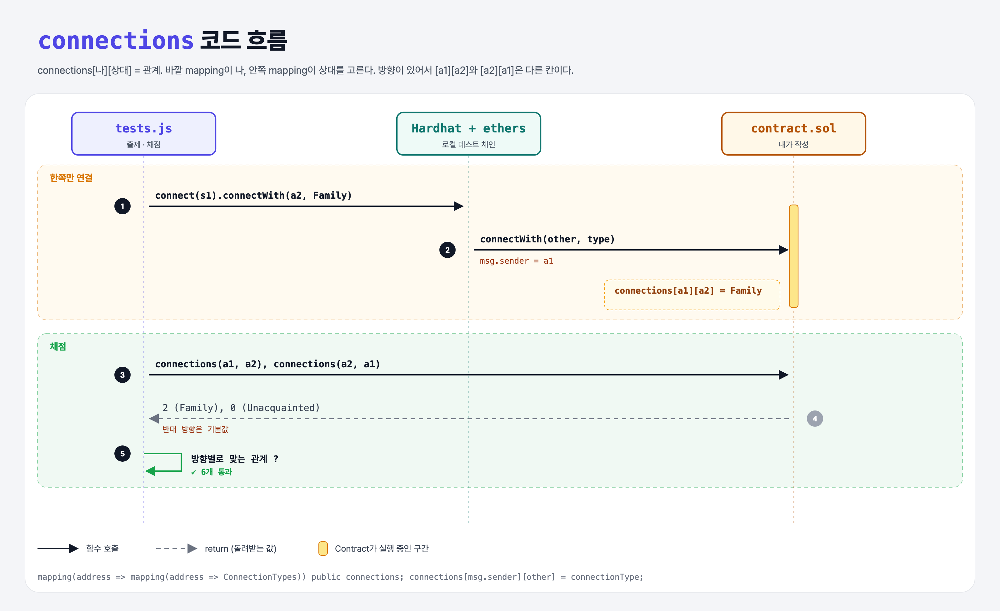

# Nested Mappings (Mappings 6단계)

## 문제

1. 주소 → (주소 → `ConnectionTypes` enum)으로 대응시키는 public 중첩 mapping `connections`를 만든다.
2. `connectWith(other, connectionType)`에서 `msg.sender` → `other` 방향의 관계를 저장한다.

## 한 줄 요약

`connections[msg.sender][other] = connectionType;` — 칸을 두 번 골라 들어간다.



---

## 0. 이 과제가 말하려는 것

> **mapping 안에 mapping을 넣으면 "누가 누구에게"처럼 두 키로 찾는 표가 된다 (DAO 투표: 안건별·주소별 찬반 등).**

```solidity
mapping(uint => mapping(address => bool)) voteToAddressChoice;
voteToAddressChoice[212][msg.sender] = true;
```

Python으로는 `connections[me][other] = kind` (dict 안의 dict).

---

## 1. 파일 구성

| 파일 | 역할 |
|------|------|
| `contract.sol` | **connections, connectWith** |
| `tests.js` | 출제 · 채점 (테스트 6개) |

---

## 2. 정답 코드

```solidity
enum ConnectionTypes { Unacquainted, Friend, Family }

mapping(address => mapping(address => ConnectionTypes)) public connections;

function connectWith(address other, ConnectionTypes connectionType) external {
    connections[msg.sender][other] = connectionType;
}
```

---

## 3. 테스트 한 줄씩

```js
const getConnection = (x, y) => contract.connections(x, y).then(Number);   // 중첩 mapping getter는 키 2개
await contract.connect(s1).connectWith(a2, TYPES.Family);
assert.equal(await getConnection(a1, a2), TYPES.Family);         // 2
assert.equal(await getConnection(a2, a1), TYPES.Unacquainted);   // 0, 반대 방향은 그대로
```

---

## 4. 일부러 틀려 보면

| 바꾼 것 | 결과 |
|---------|------|
| `connections[other][msg.sender]` | 방향이 뒤집혀 한쪽 연결 테스트 실패 |

---

## 5. 실행 방법

```bash
sh tools/sol-test.sh week5/nested-mappings
```

## 로컬 실행 환경 메모

강의 사이트는 브라우저 안에서 Hardhat으로 컴파일·테스트한다. 로컬에서는 루트에 설치한 Hardhat(ethers v5)과 `hardhat.config.js`로 똑같이 돌린다. `sh tools/sol-test.sh <폴더>`가 그 폴더의 `.sol`만 컴파일하고 테스트를 실행한다.

## 기억할 것

1. 중첩 mapping = 키 두 개로 찾는 표.
2. 방향이 있다: [a][b] ≠ [b][a].
