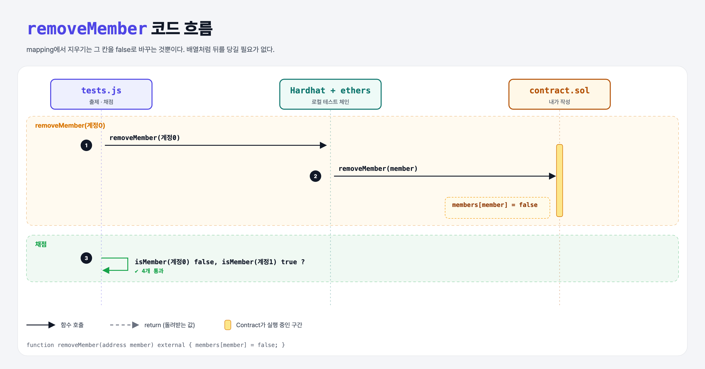

# Remove Member (Mappings 3단계)

## 문제

주소를 받아 `members`의 그 칸을 `false`로 바꾸는 external 함수 `removeMember` 만들기.

## 한 줄 요약

`members[member] = false;` — mapping은 삭제도 칸 하나만 바꾸면 끝.



---

## 0. 이 과제가 말하려는 것

> **배열에서 중간 원소를 빼면 뒤를 전부 당겨야 해서(저장소 쓰기가 많아서) 비싸다. mapping은 그럴 필요가 없다.**

- `delete members[member];`도 같은 결과다 (기본값으로 되돌림).

---

## 1. 파일 구성

| 파일 | 역할 |
|------|------|
| `contract.sol` | is-member + **removeMember** |
| `tests.js` | 출제 · 채점 (테스트 4개) |

---

## 2. 정답 코드

```solidity
function removeMember(address member) external {
    members[member] = false;
}
```

---

## 3. 테스트 한 줄씩

```js
await contract.removeMember(members[0]);
assert(!(await contract.callStatic.isMember(members[0])));   // 지운 사람은 false
assert(await contract.callStatic.isMember(members[1]));      // 다른 사람은 그대로
```

---

## 5. 실행 방법

```bash
sh tools/sol-test.sh week5/remove-member
```

## 로컬 실행 환경 메모

강의 사이트는 브라우저 안에서 Hardhat으로 컴파일·테스트한다. 로컬에서는 루트에 설치한 Hardhat(ethers v5)과 `hardhat.config.js`로 똑같이 돌린다. `sh tools/sol-test.sh <폴더>`가 그 폴더의 `.sol`만 컴파일하고 테스트를 실행한다.

## 기억할 것

1. mapping 삭제 = 기본값으로 되돌리기 (`= false` 또는 `delete`).
