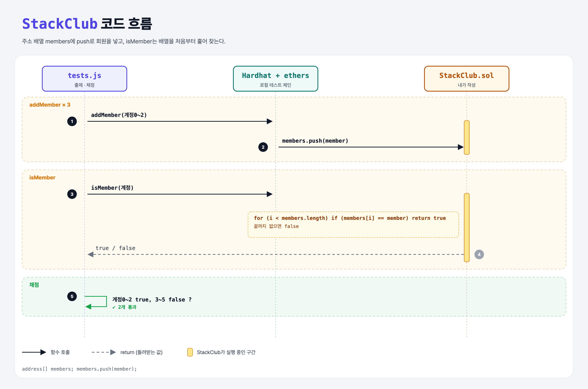

# Stack Club (Arrays 5단계)

## 문제

1. 주소 동적 배열 `members`를 만든다.
2. external `addMember(address)`: 새 회원을 추가한다.
3. public view `isMember(address)`: 회원인지 bool로 돌려준다.

## 한 줄 요약

`members.push(member)` + 배열을 처음부터 훑는 `isMember`.



---

## 0. 이 과제가 말하려는 것

회원을 위에 쌓고(push) 맨 위부터 꺼내는(pop) **스택**(LIFO, 후입선출) 구조의 클럽.

(같은 일을 mapping으로 하면 조회가 더 싸다 — members-mapping 과제와 비교)

---

## 1. 파일 구성

| 파일 | 역할 |
|------|------|
| `StackClub.sol` | **이번에 완성할 컨트랙트** |
| `tests.js` | 출제 · 채점 (테스트 2개) |

---

## 2. 정답 코드

```solidity
address[] members;

function addMember(address member) external {
    members.push(member);
}

function isMember(address member) public view returns(bool) {
    for (uint i = 0; i < members.length; i++) {
        if (members[i] == member) return true;
    }
    return false;
}
```

---

## 3. 테스트 한 줄씩

```js
for (let i = 0; i < 3; i++) await contract.addMember(accounts[i]);
assert(await contract.isMember(accounts[i]));        // 0~2: true
assert(!(await contract.isMember(accounts[i])));     // 3~5: false
```

---

## 5. 실행 방법

```bash
sh tools/sol-test.sh week5/stack-club-add
```

## 로컬 실행 환경 메모

강의 사이트는 브라우저 안에서 Hardhat으로 컴파일·테스트한다. 로컬에서는 루트의 Hardhat(ethers v5)과 `hardhat.config.js`로 똑같이 돌린다. `sh tools/sol-test.sh <폴더>`가 그 폴더의 `.sol`만 컴파일하고 테스트를 실행한다. 이 과제들은 `pragma solidity 0.8.4;`라서 설정에 0.8.4 컴파일러를 추가했다.

## 기억할 것

1. 배열 검색 = 처음부터 끝까지 비교 (회원이 많을수록 가스↑).
