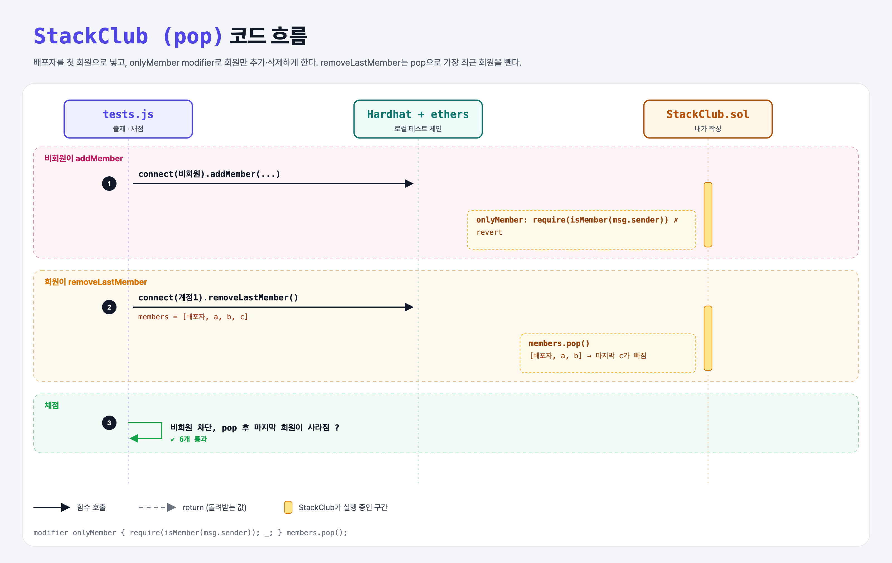

# Pop (Arrays 6단계)

## 문제

1. constructor에서 배포자를 첫 회원으로 추가한다.
2. `removeLastMember`: 가장 최근에 추가된 회원을 제거한다.
3. 🔒 `addMember`와 `removeLastMember`는 기존 회원만 부를 수 있다.

## 한 줄 요약

`members.pop()` + 공통 권한 검사는 `onlyMember` modifier로.



---

## 0. 이 과제가 말하려는 것

`pop`은 storage 배열의 마지막 원소를 지우고 길이를 1 줄인다. 4주차에서 배운 modifier로 두 함수의 권한 검사를 한곳에 모은다.

---

## 1. 파일 구성

| 파일 | 역할 |
|------|------|
| `StackClub.sol` | stack-club-add + **constructor, pop, onlyMember** |
| `tests.js` | 출제 · 채점 (테스트 6개) |

---

## 2. 정답 코드

```solidity
constructor() {
    members.push(msg.sender);
}

modifier onlyMember {
    require(isMember(msg.sender), "Only members can do this");
    _;
}

function addMember(address member) external onlyMember {
    members.push(member);
}

function removeLastMember() external onlyMember {
    members.pop();
}
```

---

## 3. 테스트 한 줄씩

```js
accounts = (await ethers.provider.listAccounts()).slice(1);   // 배포자(계정0)를 뺀 나머지
await assertRevert(contract.connect(accounts[0]).addMember(accounts[0]), "...");   // 비회원 → 실패
for (…) await contract.connect(owner).addMember(accounts[i]);  // [owner, a0, a1, a2]
await contract.connect(signer_a1).removeLastMember();          // a2 제거
assert(!(await contract.isMember(accounts[2])));
```

- `contract.connect(주소 문자열)`도 ethers v5에서는 그 주소를 쓰는 읽기 전용 provider처럼 동작해서, 거래를 보내면 실패한다 → 비회원 테스트가 의도대로 revert.

---

## 5. 실행 방법

```bash
sh tools/sol-test.sh week5/stack-club-pop
```

## 로컬 실행 환경 메모

강의 사이트는 브라우저 안에서 Hardhat으로 컴파일·테스트한다. 로컬에서는 루트의 Hardhat(ethers v5)과 `hardhat.config.js`로 똑같이 돌린다. `sh tools/sol-test.sh <폴더>`가 그 폴더의 `.sol`만 컴파일하고 테스트를 실행한다. 이 과제들은 `pragma solidity 0.8.4;`라서 설정에 0.8.4 컴파일러를 추가했다.

화면에서 잘려 보이지 않은 assert 메시지 끝부분은 짐작으로 채웠다 (채점 결과와 무관).

## 기억할 것

1. `pop()` = 마지막 원소 제거.
2. 여러 함수의 같은 검사 → modifier.
