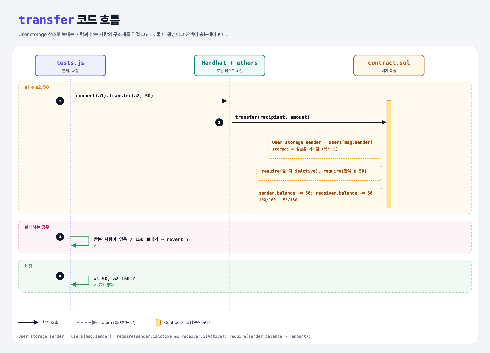

# Types of Balances (Mappings 5단계)

## 문제

external 함수 `transfer(address recipient, uint amount)`: `msg.sender`의 잔액에서 `amount`를 빼서 받는 사람 잔액에 더하기.

🔒 두 주소 모두 활성 사용자여야 하고, 보내는 사람 잔액이 충분해야 한다. 아니면 revert.

## 한 줄 요약

`User storage`로 두 사용자 구조체를 직접 가리킨 뒤 잔액을 옮긴다. 이더는 전혀 움직이지 않는다.



---

## 0. 이 과제가 말하려는 것

> **잔액에는 두 종류가 있다. 이더 잔액은 이더리움 자체가 관리하고, 토큰 잔액은 컨트랙트가 자기 mapping으로 관리한다.**

이번 토큰은 컨트랙트 안의 숫자일 뿐이라 `.call{ value }`로 이더를 보낼 필요가 없다. 숫자만 바꾸면 된다.

| | 이더 | 토큰 |
|---|---|---|
| 누가 관리 | 이더리움 상태 | 컨트랙트의 mapping |
| 보내는 방법 | `addr.call{ value: x }("")` | `balances[a] -= x; balances[b] += x;` |

---

## 1. 파일 구성

| 파일 | 역할 |
|------|------|
| `contract.sol` | mapping-structs + **transfer** |
| `tests.js` | 출제 · 채점 (테스트 7개) |

---

## 2. 정답 코드

```solidity
function transfer(address recipient, uint amount) external {
    User storage sender = users[msg.sender];
    User storage receiver = users[recipient];
    require(sender.isActive && receiver.isActive, "Both users must be active");
    require(sender.balance >= amount, "Not enough balance");

    sender.balance -= amount;
    receiver.balance += amount;
}
```

| 키워드 | 뜻 |
|--------|-----|
| `storage` | 저장소의 **원본을 가리키는** 참조. 고치면 바로 저장된다 (Python 객체 참조와 비슷) |
| `memory` | 함수 안에서만 쓰는 **복사본**. 고쳐도 저장소는 그대로 |

---

## 3. 테스트 한 줄씩

```js
// 받는 사람이 아직 없음 → revert
await contract.connect(a1).transfer(await a2.getAddress(), 50);   // 에러가 나야 함
// a2 생성 후
await contract.connect(a1).transfer(await a2.getAddress(), 50);
assert.equal(user1.balance, 50);   assert.equal(user2.balance, 150);
// 150 보내기 (잔액 100) → revert
```

---

## 4. 일부러 틀려 보면

| 바꾼 것 | 결과 |
|---------|------|
| `User memory sender = users[msg.sender];` | 복사본만 바뀌어 잔액이 그대로 → 송금 테스트 실패 |
| 잔액 확인 require 생략 | 0.8부터는 `100 - 150`이 underflow로 자동 revert되어 이 테스트는 통과하지만, 의도를 코드로 드러내는 게 좋다 |

---

## 5. 실행 방법

```bash
sh tools/sol-test.sh week5/transfer-amount
```

## 로컬 실행 환경 메모

강의 사이트는 브라우저 안에서 Hardhat으로 컴파일·테스트한다. 로컬에서는 루트에 설치한 Hardhat(ethers v5)과 `hardhat.config.js`로 똑같이 돌린다. `sh tools/sol-test.sh <폴더>`가 그 폴더의 `.sol`만 컴파일하고 테스트를 실행한다.

화면에서 잘려 보이지 않은 assert 메시지 끝부분은 짐작으로 채웠다 (채점 결과와 무관).

## 기억할 것

1. 토큰 잔액 = 컨트랙트 장부의 숫자.
2. 원본을 고치려면 `storage` 참조.
3. 보내는 쪽 검사 → 상태 변경 순서.
