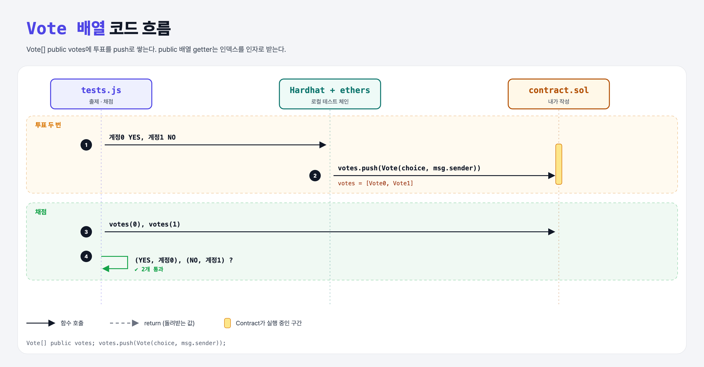

# Vote Array (Structs 3단계)

## 문제

public `Vote[] votes`를 만들고, `createVote`가 새 Vote를 push하게 하기.

## 한 줄 요약

`votes.push(Vote(choice, msg.sender));`



---

## 0. 이 과제가 말하려는 것

struct도 배열에 담을 수 있다. 여러 사람의 투표를 차례로 쌓는다.

---

## 1. 파일 구성

| 파일 | 역할 |
|------|------|
| `contract.sol` | **votes, createVote (push)** |
| `tests.js` | 출제 · 채점 (테스트 2개) |

---

## 2. 정답 코드

```solidity
Vote[] public votes;

function createVote(Choices choice) external {
    votes.push(Vote(choice, msg.sender));
}
```

---

## 3. 테스트 한 줄씩

```js
const vote = await contract.votes(0);   // public 배열 getter = 인덱스로 하나씩
assert.equal(vote.choice, CHOICES.YES);
```

---

## 5. 실행 방법

```bash
sh tools/sol-test.sh week5/vote-array
```

## 로컬 실행 환경 메모

강의 사이트는 브라우저 안에서 Hardhat으로 컴파일·테스트한다. 로컬에서는 루트의 Hardhat(ethers v5)과 `hardhat.config.js`로 똑같이 돌린다. `sh tools/sol-test.sh <폴더>`가 그 폴더의 `.sol`만 컴파일하고 테스트를 실행한다. 이 과제들은 `pragma solidity 0.8.4;`라서 설정에 0.8.4 컴파일러를 추가했다.

## 기억할 것

1. struct 배열 = `T[]`, push로 추가.
