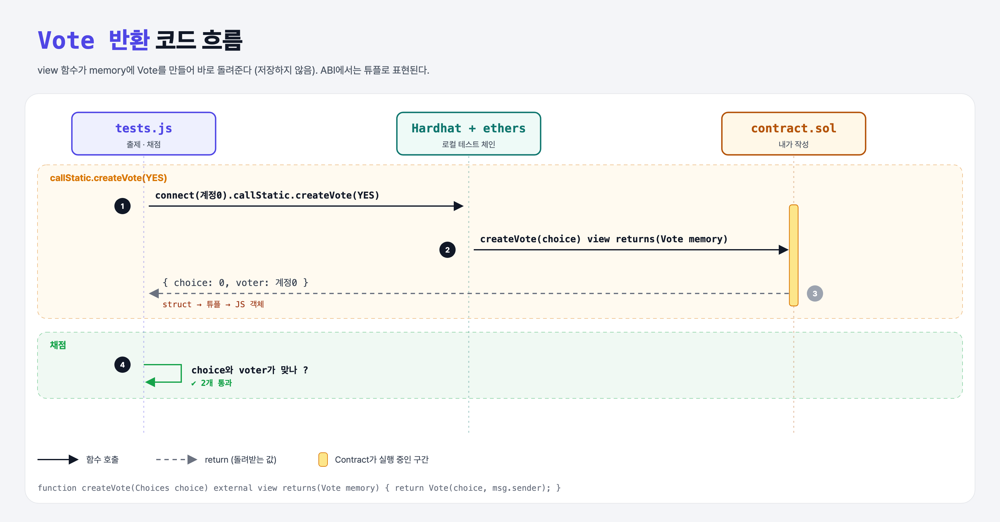

# Vote Memory (Structs 2단계)

## 문제

Choices 값을 받아 `Vote`를 **돌려주는** external view 함수 `createVote` 만들기 (choice와 msg.sender 사용, 저장은 안 함).

## 한 줄 요약

`returns(Vote memory)` + `return Vote(choice, msg.sender);`



---

## 0. 이 과제가 말하려는 것

> **ABI encoder v2 덕분에 struct를 외부 함수의 인자·반환값으로 쓸 수 있다. ABI에서는 튜플(`tuple`)로 표현된다.**

- `pragma experimental ABIEncoderV2;`는 0.8부터 기본이라 없어도 되지만, 강의 코드에 있어서 그대로 뒀다.

---

## 1. 파일 구성

| 파일 | 역할 |
|------|------|
| `contract.sol` | **createVote (view, Vote 반환)** |
| `tests.js` | 출제 · 채점 (테스트 2개) |

---

## 2. 정답 코드

```solidity
function createVote(Choices choice) external view returns(Vote memory) {
    return Vote(choice, msg.sender);
}
```

`msg.sender`를 읽으므로 pure가 아니라 view다.

---

## 3. 테스트 한 줄씩

```js
vote = await contract.connect(accounts[0].signer).callStatic.createVote(CHOICES.YES);   // 읽기 호출의 msg.sender도 connect한 계정
assert.equal(vote.voter, accounts[0].address);
```

---

## 5. 실행 방법

```bash
sh tools/sol-test.sh week5/vote-memory
```

## 로컬 실행 환경 메모

강의 사이트는 브라우저 안에서 Hardhat으로 컴파일·테스트한다. 로컬에서는 루트의 Hardhat(ethers v5)과 `hardhat.config.js`로 똑같이 돌린다. `sh tools/sol-test.sh <폴더>`가 그 폴더의 `.sol`만 컴파일하고 테스트를 실행한다. 이 과제들은 `pragma solidity 0.8.4;`라서 설정에 0.8.4 컴파일러를 추가했다.

## 기억할 것

1. struct 반환 = `returns(T memory)`.
