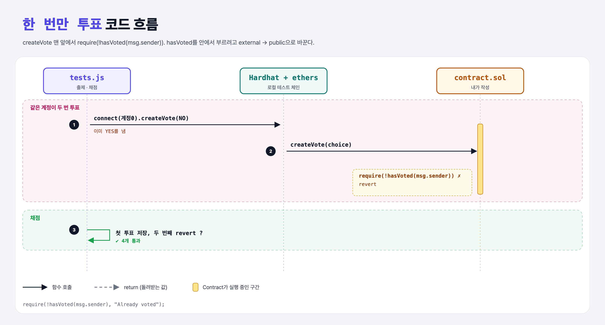

# Vote Once (Structs 5단계)

## 문제

같은 주소는 `createVote`를 **한 번만** 부를 수 있게 하기. 다시 부르면 revert.

## 한 줄 요약

`require(!hasVoted(msg.sender));` — 안에서 쓰려고 hasVoted를 `external` → `public`.



---

## 0. 이 과제가 말하려는 것

external 함수는 컨트랙트 안에서 이름으로 부를 수 없다. 안팎에서 다 쓰려면 public.

---

## 1. 파일 구성

| 파일 | 역할 |
|------|------|
| `contract.sol` | choice-lookup + **중복 투표 차단** |
| `tests.js` | 출제 · 채점 (테스트 4개) |

---

## 2. 정답 코드

```solidity
function createVote(Choices choice) external {
    require(!hasVoted(msg.sender), "Already voted");
    votes.push(Vote(choice, msg.sender));
}

function hasVoted(address voter) public view returns(bool) { ... }
```

---

## 3. 테스트 한 줄씩

```js
await contract.connect(accounts[0].signer).createVote(CHOICES.NO);   // 두 번째 → 에러가 나야 통과
```

---

## 4. 일부러 틀려 보면

| 바꾼 것 | 결과 |
|---------|------|
| hasVoted를 external로 둔 채 안에서 호출 | 컴파일 에러: Undeclared identifier (external은 내부 호출 불가) |

---

## 5. 실행 방법

```bash
sh tools/sol-test.sh week5/vote-once
```

## 로컬 실행 환경 메모

강의 사이트는 브라우저 안에서 Hardhat으로 컴파일·테스트한다. 로컬에서는 루트의 Hardhat(ethers v5)과 `hardhat.config.js`로 똑같이 돌린다. `sh tools/sol-test.sh <폴더>`가 그 폴더의 `.sol`만 컴파일하고 테스트를 실행한다. 이 과제들은 `pragma solidity 0.8.4;`라서 설정에 0.8.4 컴파일러를 추가했다.

## 기억할 것

1. 내부에서도 쓰려면 public.
