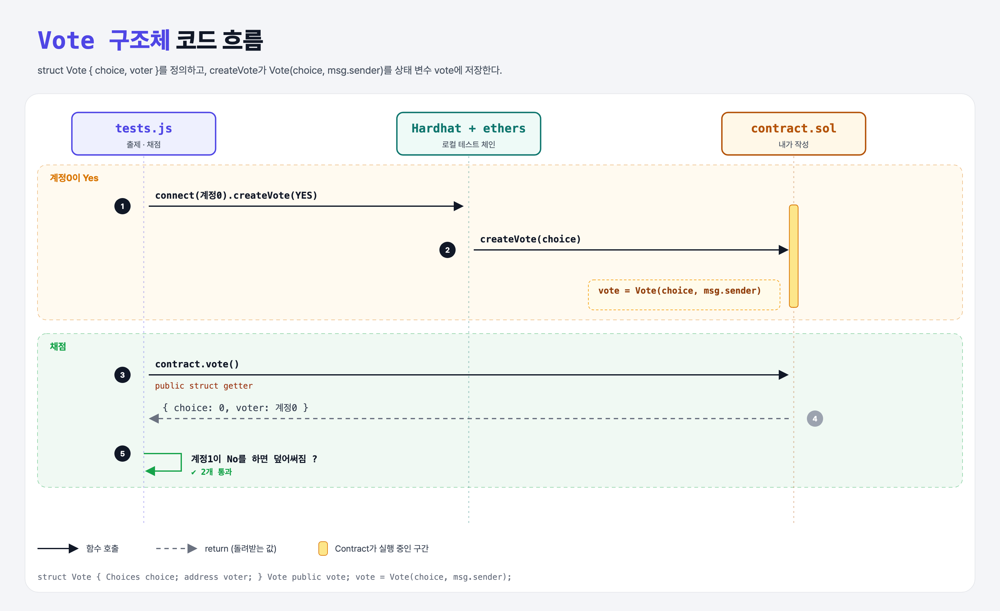

# Vote Storage (Structs 1단계)

## 문제

1. `Choices choice`와 `address voter`를 가진 구조체 `Vote`를 만든다.
2. public 상태 변수 `vote` (Vote 타입).
3. `createVote(choice)`에서 `Vote(choice, msg.sender)`를 만들어 `vote`에 저장.

## 한 줄 요약

`struct Vote { Choices choice; address voter; }` + `vote = Vote(choice, msg.sender);`



---

## 0. 이 과제가 말하려는 것

> **struct = 여러 변수를 묶은 사용자 정의 타입 (Python의 dataclass, JS 객체와 비슷).**

```
[struct 저장] → struct 반환 → struct 배열 → 투표 찾기 → 한 번만 → 투표 바꾸기
 ★ 이 단계     vote-memory  vote-array  choice-lookup  vote-once  change-vote
```

- 만들 때 필드 **순서대로** 값을 넣거나, `Vote({ choice: c, voter: v })`처럼 이름을 붙인다.
- `.`으로 필드에 접근: `vote.choice`.

---

## 1. 파일 구성

| 파일 | 역할 |
|------|------|
| `contract.sol` | **Vote, vote, createVote** |
| `tests.js` | 출제 · 채점 (테스트 2개) |

---

## 2. 정답 코드

```solidity
enum Choices { Yes, No }

struct Vote {
    Choices choice;
    address voter;
}

Vote public vote;

function createVote(Choices choice) external {
    vote = Vote(choice, msg.sender);
}
```

---

## 3. 테스트 한 줄씩

```js
await contract.connect(accounts[0].signer).createVote(CHOICES.YES);
const vote = await contract.vote();          // public struct getter → { choice, voter }
assert.equal(vote.choice, CHOICES.YES);
assert.equal(vote.voter, accounts[0].address);
```

---

## 5. 실행 방법

```bash
sh tools/sol-test.sh week5/vote-storage
```

## 로컬 실행 환경 메모

강의 사이트는 브라우저 안에서 Hardhat으로 컴파일·테스트한다. 로컬에서는 루트의 Hardhat(ethers v5)과 `hardhat.config.js`로 똑같이 돌린다. `sh tools/sol-test.sh <폴더>`가 그 폴더의 `.sol`만 컴파일하고 테스트를 실행한다. 이 과제들은 `pragma solidity 0.8.4;`라서 설정에 0.8.4 컴파일러를 추가했다.

## 기억할 것

1. struct = 묶음 타입, `.`으로 필드 접근.
