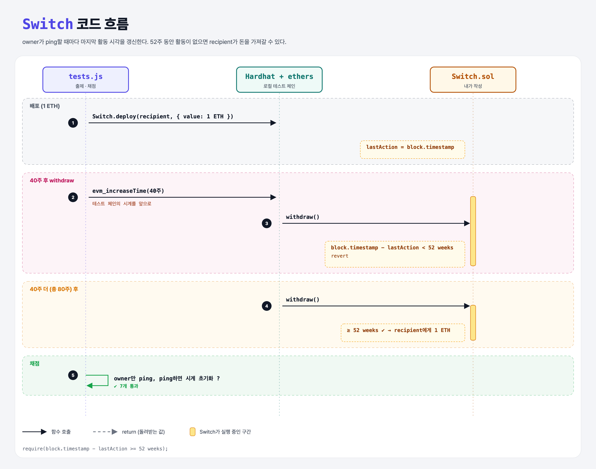

# Dead Man's Switch

## 문제

owner가 52주에 한 번은 `ping`해야 하는 컨트랙트. 52주 동안 활동이 없으면 recipient가 돈을 가져갈 수 있다.

1. public payable **constructor**: recipient 주소를 받는다.
2. external **withdraw**: 컨트랙트의 돈을 전부 recipient에게 보낸다.
3. external **ping**: 비활동 기간을 다시 시작한다.
4. 🔒 ping은 owner만. withdraw는 마지막 활동 후 52주가 지나야만.

## 한 줄 요약

마지막 활동 시각 `lastAction = block.timestamp`를 기록하고, `block.timestamp - lastAction >= 52 weeks`로 확인.



---

## 0. 이 과제가 말하려는 것

> **블록체인에서 시간을 다루는 법: `block.timestamp`(초)와 시간 단위(`seconds`, `minutes`, `hours`, `days`, `weeks`).**

- "dead man's switch" = 사람이 움직이지 않게 되면 자동으로 작동하는 장치. 유산 상속 등에 쓸 수 있다.
- `years`는 윤년 때문에 없다. 그래서 52 weeks.

---

## 1. 파일 구성

| 파일 | 역할 |
|------|------|
| `Switch.sol` | **이번에 완성할 컨트랙트** |
| `tests.js` | 출제 · 채점 (테스트 7개) |

---

## 2. 정답 코드

```solidity
address owner;
address recipient;
uint lastAction;

constructor(address _recipient) payable {
    owner = msg.sender;
    recipient = _recipient;
    lastAction = block.timestamp;
}

function ping() external {
    require(msg.sender == owner, "Only the owner can ping");
    lastAction = block.timestamp;
}

function withdraw() external {
    require(block.timestamp - lastAction >= 52 weeks, "Owner is still active");
    (bool sent, ) = recipient.call{ value: address(this).balance }("");
    require(sent, "Failed to send ether");
}
```

---

## 3. 테스트 한 줄씩

```js
const passTime = (time) => ethers.provider.send('evm_increaseTime', [time]);   // 테스트 체인 시계를 앞당김
await passTime(oneWeek * 40);
// 40주 → withdraw 실패, 80주 → 성공, 중간에 ping하면 다시 52주 필요

async function assertBalanceChange(address, change, tx, msg) {
    const { gasUsed } = await (await tx()).wait();
    const gasInWei = ethers.utils.parseUnits(gasUsed.toString(), "gwei");   // gasPrice 1 gwei로 보냈으니 가스비 = gasUsed gwei
    assert.equal(change.toString(), balanceAfter.add(gasInWei).sub(balanceBefore).toString(), msg);
}
```

---

## 4. 일부러 틀려 보면

| 바꾼 것 | 결과 |
|---------|------|
| `> 52 weeks` | 정확히 52주째엔 실패하지만, 이 테스트(70·80주)에선 통과한다 |
| ping에 owner 확인 없음 | recipient가 ping은 못 해도 다른 사람이 ping으로 계속 막을 수 있음 → 'other account' 테스트 실패 |

---

## 5. 실행 방법

```bash
sh tools/sol-test.sh week6/dead-mans-switch
```

## 로컬 실행 환경 메모

강의 사이트는 브라우저 안에서 Hardhat으로 컴파일·테스트한다. 로컬에서는 루트의 Hardhat(ethers v5)으로 똑같이 돌린다: `sh tools/sol-test.sh <폴더>`.

## 기억할 것

1. `block.timestamp` + 시간 단위(`52 weeks`).
2. 테스트에선 `evm_increaseTime`으로 시간을 건너뛴다.
