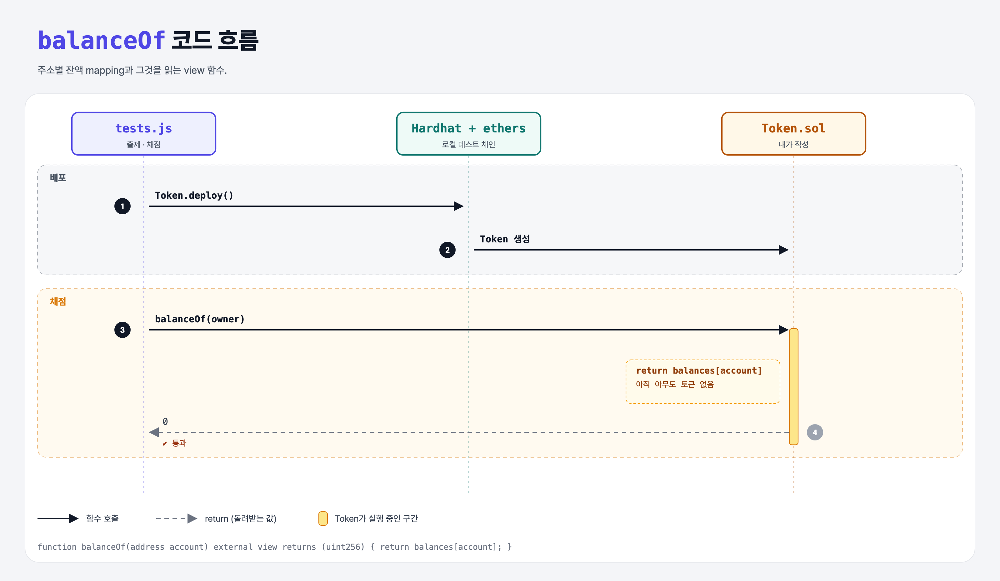

# Balances (Build an ERC-20 3단계)

## 문제

1. 주소 → `uint256` mapping으로 잔액을 저장한다.
2. external view 함수 `balanceOf(address)`가 그 주소의 잔액을 돌려준다.

## 한 줄 요약

`mapping(address => uint256) balances;` + `balanceOf`에서 `return balances[account];`.



---

## 0. 이 과제가 말하려는 것

> **ERC-20의 핵심 자료구조는 결국 `dict[주소] = 잔액` 하나.**

```python
balances = defaultdict(int)
def balance_of(account): return balances[account]
```

`mapping`을 `public`으로 만들면 getter 이름이 `balances`가 되므로, 표준 이름 `balanceOf`는 함수로 따로 만든다.

---

## 1. 파일 구성

| 파일 | 역할 |
|------|------|
| `Token.sol` | config + **balances, balanceOf** |
| `tests.js` | 출제 · 채점 (테스트 5개) |

---

## 2. 정답 코드

```solidity
mapping(address => uint256) balances;

function balanceOf(address account) external view returns (uint256) {
    return balances[account];
}
```

---

## 3. 테스트 한 줄씩

```js
const accounts = await ethers.provider.listAccounts();
owner = accounts[0];
const balance = await token.callStatic.balanceOf(owner);
assert.equal(balance.toString(), '0');   // 아직 아무도 토큰이 없다
```

---

## 5. 실행 방법

```bash
sh tools/sol-test.sh week6/erc20-balances
```

## 로컬 실행 환경 메모

강의 사이트는 브라우저 안에서 Hardhat으로 컴파일·테스트한다. 로컬에서는 루트의 Hardhat(ethers v5)으로 똑같이 돌린다: `sh tools/sol-test.sh <폴더>`.

## 기억할 것

1. 잔액 = `mapping(address => uint256)`.
2. 없는 키를 읽으면 0.
