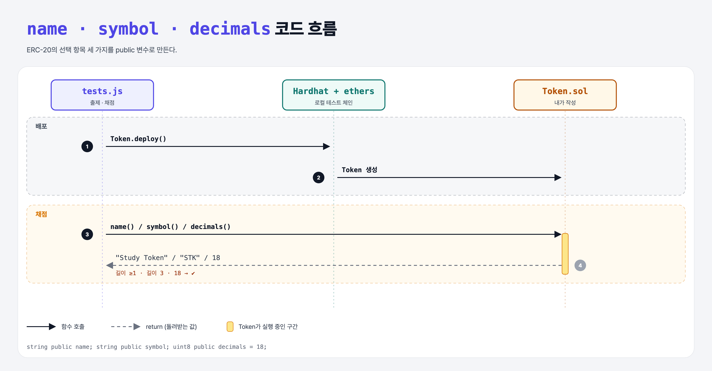

# Configuration (Build an ERC-20 2단계)

## 문제

public 상태 변수 세 개:

1. `string name` — 1글자 이상
2. `string symbol` — 3글자
3. `uint8 decimals` — 18

## 한 줄 요약

`name = "Study Token"`, `symbol = "STK"`, `decimals = 18`.



---

## 0. 이 과제가 말하려는 것

> **이름·기호·소수 자리는 ERC-20에서 "선택" 항목이지만 지갑과 거래소 화면에 보이려면 사실상 필수.**

`decimals = 18`의 뜻: 컨트랙트 안의 숫자 `1000000000000000000`(10^18)을 화면에서는 `1`개로 보여 준다. 이더의 wei ↔ ETH와 같은 관계.

```python
display = raw / 10**18
```

---

## 1. 파일 구성

| 파일 | 역할 |
|------|------|
| `Token.sol` | supply + **name, symbol, decimals** |
| `tests.js` | 출제 · 채점 (테스트 4개) |

---

## 2. 정답 코드

```solidity
uint public totalSupply;
string public name = "Study Token";
string public symbol = "STK";
uint8 public decimals = 18;
```

---

## 3. 테스트 한 줄씩

```js
assert.isAtLeast(name.length, 1);
assert.equal(sym.length, 3);
assert.equal(decimals, 18);     // uint8은 ethers에서 BigNumber가 아니라 그냥 숫자로 온다
```

---

## 5. 실행 방법

```bash
sh tools/sol-test.sh week6/erc20-config
```

## 로컬 실행 환경 메모

강의 사이트는 브라우저 안에서 Hardhat으로 컴파일·테스트한다. 로컬에서는 루트의 Hardhat(ethers v5)으로 똑같이 돌린다: `sh tools/sol-test.sh <폴더>`.

## 기억할 것

1. decimals 18 = 10^18이 1개.
2. name/symbol/decimals는 표준상 선택이지만 관례상 넣는다.
