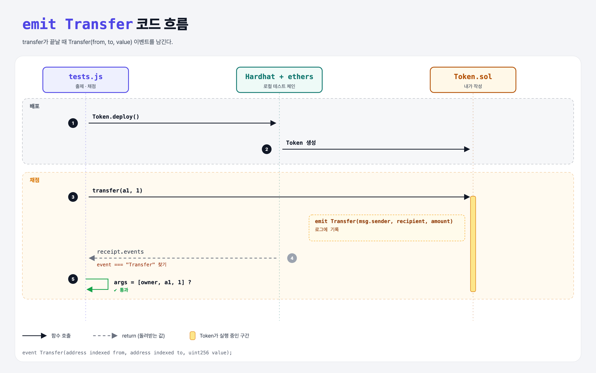

# Transfer Event (Build an ERC-20 6단계)

## 문제

1. 이벤트 `Transfer(보낸 주소, 받는 주소, uint256 금액)`을 이 순서로 만든다.
2. `transfer` 안에서 emit한다.

## 한 줄 요약

`event Transfer(address indexed from, address indexed to, uint256 value);` + `emit Transfer(msg.sender, recipient, amount);`



---

## 0. 이 과제가 말하려는 것

> **지갑·거래소·Etherscan은 잔액을 매번 다시 읽지 않고 `Transfer` 이벤트를 구독해서 변화를 안다.**

- `indexed`를 붙인 인자는 검색할 수 있는 topic이 된다 ("이 주소가 받은 Transfer만" 같은 필터).
- 표준 ERC-20의 `Transfer` 시그니처와 똑같이 맞춰야 다른 앱이 알아본다.

---

## 1. 파일 구성

| 파일 | 역할 |
|------|------|
| `Token.sol` | transfer + **Transfer 이벤트** |
| `tests.js` | 출제 · 채점 (테스트 13개) |

---

## 2. 정답 코드

```solidity
event Transfer(address indexed from, address indexed to, uint256 value);

function transfer(address recipient, uint amount) public returns (bool) {
    require(balances[msg.sender] >= amount, "Not enough balance");
    balances[msg.sender] -= amount;
    balances[recipient] += amount;
    emit Transfer(msg.sender, recipient, amount);
    return true;
}
```

---

## 3. 테스트 한 줄씩

```js
const tx = await token.connect(ownerSigner).transfer(a1, "1");
receipt = await tx.wait();
const transferEvent = receipt.events.find(x => x.event === "Transfer");
assert.equal(transferEvent.args[0], owner);     // from
assert.equal(transferEvent.args[1], a1);        // to
assert.equal(transferEvent.args[2].toString(), "1");
```

---

## 4. 일부러 틀려 보면

| 바꾼 것 | 결과 |
|---------|------|
| `emit Transfer(recipient, msg.sender, amount)` (순서 반대) | 이벤트는 나오지만 from/to가 뒤바뀌어 이벤트 테스트 2개 실패 |

---

## 5. 실행 방법

```bash
sh tools/sol-test.sh week6/erc20-events
```

## 로컬 실행 환경 메모

강의 사이트는 브라우저 안에서 Hardhat으로 컴파일·테스트한다. 로컬에서는 루트의 Hardhat(ethers v5)으로 똑같이 돌린다: `sh tools/sol-test.sh <폴더>`.

## 기억할 것

1. 상태를 바꾸면 이벤트로 알린다.
2. 표준 이벤트 이름·인자 순서를 정확히.
