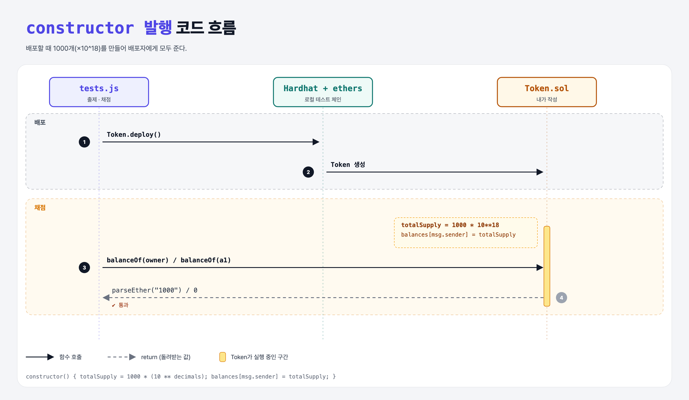

# Minting (Build an ERC-20 4단계)

## 문제

constructor에서:

1. `totalSupply`를 토큰 **1000개**로 정한다 (decimals 18 반영).
2. 배포자 잔액을 `totalSupply`로 만든다.

## 한 줄 요약

`totalSupply = 1000 * (10 ** decimals); balances[msg.sender] = totalSupply;`



---

## 0. 이 과제가 말하려는 것

> **발행(mint) = 토큰을 새로 만들어 누군가의 잔액에 넣는 것. 이번엔 배포할 때 한 번에 전부 배포자에게.**

| 1000개 | 컨트랙트 안의 숫자 |
|--------|-------------------|
| `1000 * 10**18` | `1000000000000000000000` |
| 테스트 쪽 | `ethers.utils.parseEther("1000")` (같은 값) |

실무에서는 OpenZeppelin `ERC20`의 `_mint(msg.sender, amount)`를 쓴다.

---

## 1. 파일 구성

| 파일 | 역할 |
|------|------|
| `Token.sol` | balances + **constructor** |
| `tests.js` | 출제 · 채점 (테스트 6개) |

---

## 2. 정답 코드

```solidity
constructor() {
    totalSupply = 1000 * (10 ** decimals);
    balances[msg.sender] = totalSupply;
}
```

---

## 3. 테스트 한 줄씩

```js
const totalSupply = ethers.utils.parseEther("1000");   // 1000 * 10^18
assert.equal((await token.balanceOf(owner)).toString(), totalSupply.toString());
assert.equal((await token.balanceOf(a1)).toString(), '0');
```

---

## 4. 일부러 틀려 보면

| 바꾼 것 | 결과 |
|---------|------|
| `totalSupply = 1000;` | 잔액이 `1000`(= 0.000…001개)이라 parseEther("1000")과 달라서 실패 |

---

## 5. 실행 방법

```bash
sh tools/sol-test.sh week6/erc20-mint
```

## 로컬 실행 환경 메모

강의 사이트는 브라우저 안에서 Hardhat으로 컴파일·테스트한다. 로컬에서는 루트의 Hardhat(ethers v5)으로 똑같이 돌린다: `sh tools/sol-test.sh <폴더>`.

## 기억할 것

1. 개수 × 10^decimals 로 저장.
2. 배포자 = constructor의 `msg.sender`.
