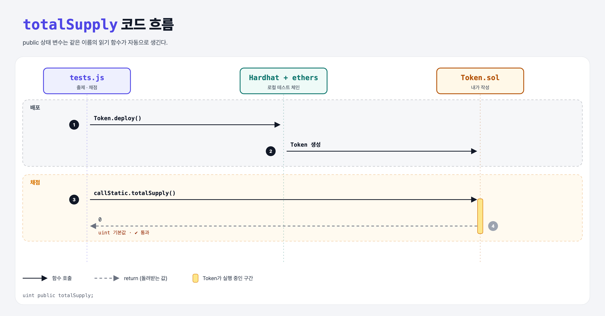

# Token Supply (Build an ERC-20 1단계)

## 문제

public `uint` 상태 변수 `totalSupply`를 만든다. 값은 기본값 0 그대로 둔다.

## 한 줄 요약

`uint public totalSupply;` — public 변수는 같은 이름의 읽기 함수 `totalSupply()`가 자동으로 생긴다.



---

## 0. 이 과제가 말하려는 것

> **ERC-20 토큰을 처음부터 직접 만든다. 첫 단계는 전체 발행량.**

```
[supply] → config → balances → mint → transfer → events
```

ERC-20 표준은 `totalSupply()`라는 **함수**를 요구한다. public 변수를 만들면 Solidity가 그 함수를 대신 만들어 주므로 이것만으로 표준을 맞춘다.

---

## 1. 파일 구성

| 파일 | 역할 |
|------|------|
| `Token.sol` | **이번에 완성할 컨트랙트** |
| `tests.js` | 출제 · 채점 (테스트 1개) |

---

## 2. 정답 코드

```solidity
contract Token {
    uint public totalSupply;
}
```

---

## 3. 테스트 한 줄씩

```js
const result = await token.callStatic.totalSupply();
assert.equal(result.toString(), '0');   // BigNumber → 문자열로 비교
```

---

## 5. 실행 방법

```bash
sh tools/sol-test.sh week6/erc20-supply
```

## 로컬 실행 환경 메모

강의 사이트는 브라우저 안에서 Hardhat으로 컴파일·테스트한다. 로컬에서는 루트의 Hardhat(ethers v5)으로 똑같이 돌린다: `sh tools/sol-test.sh <폴더>`.

## 기억할 것

1. public 변수 = 자동 getter 함수.
2. uint 기본값은 0.
