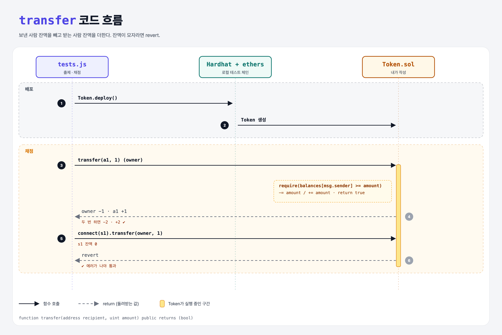

# Transfer (Build an ERC-20 5단계)

## 문제

public 함수 `transfer(address recipient, uint amount)`:

1. 호출자의 잔액에서 `amount`를 빼고 recipient에 더한다.
2. 성공하면 `true`를 돌려준다.
3. 🔒 호출자 잔액이 모자라면 revert.

## 한 줄 요약

`require(balances[msg.sender] >= amount)` → `-=` / `+=` → `return true`.



---

## 0. 이 과제가 말하려는 것

> **토큰 전송은 돈이 실제로 움직이는 게 아니라, 토큰 컨트랙트 안의 mapping 숫자 두 개를 고치는 것.**

```python
def transfer(sender, recipient, amount):
    assert balances[sender] >= amount
    balances[sender] -= amount
    balances[recipient] += amount
    return True
```

---

## 1. 파일 구성

| 파일 | 역할 |
|------|------|
| `Token.sol` | mint + **transfer** |
| `tests.js` | 출제 · 채점 (테스트 11개) |

---

## 2. 정답 코드

```solidity
function transfer(address recipient, uint amount) public returns (bool) {
    require(balances[msg.sender] >= amount, "Not enough balance");
    balances[msg.sender] -= amount;
    balances[recipient] += amount;
    return true;
}
```

---

## 3. 테스트 한 줄씩

```js
await token.connect(ownerSigner).transfer(a1, "1");   // owner −1, a1 +1
// 두 번째 transfer 후 owner −2, a1 2
await token.connect(s1).transfer(owner, "1");         // s1은 잔액 0 → 에러가 나야 통과
```

---

## 4. 일부러 틀려 보면

| 바꾼 것 | 결과 |
|---------|------|
| `require` 줄 빼기 | 그래도 11개 모두 통과한다. Solidity 0.8은 `0 - 1`처럼 음수가 되는 뺄셈을 자동으로 revert(panic 0x11)하기 때문. 다만 에러 메시지가 없어서 이유를 알기 어렵다 → require를 두는 게 좋다 |

---

## 5. 실행 방법

```bash
sh tools/sol-test.sh week6/erc20-transfer
```

## 로컬 실행 환경 메모

강의 사이트는 브라우저 안에서 Hardhat으로 컴파일·테스트한다. 로컬에서는 루트의 Hardhat(ethers v5)으로 똑같이 돌린다: `sh tools/sol-test.sh <폴더>`.

## 기억할 것

1. 잔액 확인 → 빼기 → 더하기 → `return true`.
2. 0.8부터는 언더플로가 자동 revert.
