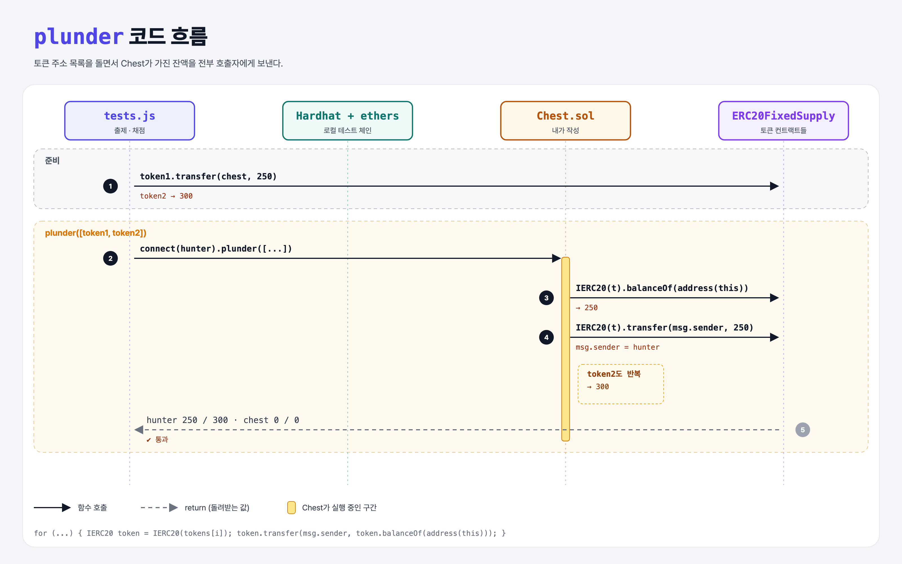

# ERC-20 Treasure Chest

## 문제

여러 ERC-20 토큰이 `Chest` 컨트랙트 주소로 보내져 있다.

external 함수 `plunder(address[] 토큰주소들)`: 각 토큰에서 **Chest가 가진 잔액 전부**를 호출자(`msg.sender`)에게 보낸다.

## 한 줄 요약

토큰 주소마다 `IERC20(addr).balanceOf(address(this))`로 잔액을 읽고 `transfer(msg.sender, 잔액)`.



---

## 0. 이 과제가 말하려는 것

> **컨트랙트도 토큰을 가질 수 있다. 꺼낼 때는 그 컨트랙트가 직접 토큰 컨트랙트의 `transfer`를 불러야 한다.**

- 토큰 잔액은 Chest 안이 아니라 **각 토큰 컨트랙트의 mapping**에 `balances[Chest 주소]`로 적혀 있다.
- Chest가 `token.transfer(...)`를 부르면 토큰 컨트랙트 입장에서 `msg.sender`는 **Chest**다. 그래서 Chest의 잔액에서 빠져나간다.
- `IERC20` 인터페이스만 있으면 어떤 ERC-20이든 같은 방식으로 다룰 수 있다. 이게 표준의 힘.

---

## 1. 파일 구성

| 파일 | 역할 |
|------|------|
| `Chest.sol` | **이번에 완성할 컨트랙트** |
| `IERC20.sol` | ERC-20 인터페이스 (주어짐) |
| `ERC20FixedSupply.sol` | 로컬 실행용 테스트 토큰 (사이트에선 숨겨짐) |
| `tests.js` | 출제 · 채점 (테스트 13개) |

---

## 2. 정답 코드

```solidity
function plunder(address[] calldata tokens) external {
    for (uint i = 0; i < tokens.length; i++) {
        IERC20 token = IERC20(tokens[i]);
        uint balance = token.balanceOf(address(this));
        token.transfer(msg.sender, balance);
    }
}
```

`calldata`: 외부에서 받은 배열을 복사하지 않고 읽기만 해서 가스가 싸다 (`memory`도 통과한다).

```python
for addr in tokens:
    token = IERC20(addr)
    token.transfer(caller, token.balance_of(chest))
```

---

## 3. 테스트 한 줄씩

```js
token1 = await ERC20.deploy(10000);
await token1.connect(coinCreatorSigner).transfer(chest.address, 250);
await token2.connect(coinCreatorSigner).transfer(chest.address, 300);
await chest.connect(hunterSigner).plunder([token2.address]);   // token2만 → token1은 그대로 250
await chest.connect(hunterSigner).plunder([token1.address, token2.address]);   // 둘 다 → chest 0 / 0
```

---

## 4. 일부러 틀려 보면

| 바꾼 것 | 결과 |
|---------|------|
| `transfer` 대신 `transferFrom(address(this), msg.sender, balance)` | Chest가 자기 자신에게 allowance를 준 적이 없어서 revert → 꺼내는 테스트 실패. 자기 토큰은 `transfer`로 보낸다 |

---

## 5. 실행 방법

```bash
sh tools/sol-test.sh week6/erc20-treasure-chest
```

## 로컬 실행 환경 메모

강의 사이트는 브라우저 안에서 Hardhat으로 컴파일·테스트한다. 로컬에서는 루트의 Hardhat(ethers v5)으로 똑같이 돌린다: `sh tools/sol-test.sh <폴더>`.

사이트에는 테스트용 컨트랙트(`ERC20FixedSupply`)가 숨겨져 있어서, 로컬 실행용으로 같은 역할을 하는 파일을 직접 만들어 두었다.

## 기억할 것

1. 토큰 잔액은 토큰 컨트랙트 쪽 mapping에 있다.
2. 컨트랙트가 부르면 `msg.sender` = 그 컨트랙트.
