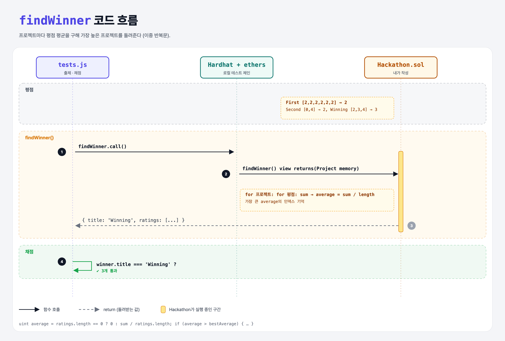

# Hackathon (Top Rated Project)

## 문제

external view 함수 `findWinner`: 평점 배열의 **평균**이 가장 높은 프로젝트(`Project`)를 돌려주기.

## 한 줄 요약

바깥 반복문은 프로젝트, 안쪽 반복문은 평점 합계. 평균이 최고면 그 인덱스를 기억해 두었다가 반환.



---

## 0. 이 과제가 말하려는 것

> **struct 안의 배열, 이중 반복문, 정수 나눗셈을 함께 다루는 문제.**

| 프로젝트 | 평점 | 평균 (정수 나눗셈) |
|----------|------|-------------------|
| First | 2, 2, 2, 2, 2, 2 | 2 |
| Second | 0, 4 | 2 |
| Winning | 2, 3, 4 | 3 ✔ |

---

## 1. 파일 구성

| 파일 | 역할 |
|------|------|
| `Hackathon.sol` | **findWinner 추가** (struct, newProject, rate는 주어짐) |
| `tests.js` | 출제 · 채점 (테스트 3개) |

---

## 2. 정답 코드

```solidity
function findWinner() external view returns(Project memory) {
    uint bestIndex;
    uint bestAverage;
    for (uint i = 0; i < projects.length; i++) {
        uint[] storage ratings = projects[i].ratings;
        uint sum;
        for (uint j = 0; j < ratings.length; j++) {
            sum += ratings[j];
        }
        uint average = ratings.length == 0 ? 0 : sum / ratings.length;
        if (average > bestAverage) {
            bestAverage = average;
            bestIndex = i;
        }
    }
    return projects[bestIndex];
}
```

- `uint[] storage ratings = …`: 복사하지 않고 원본을 가리켜서 가스를 아낀다.
- 평점이 없는 프로젝트는 0으로 나누기 에러를 피하려고 평균 0.

```python
best = max(projects, key=lambda p: sum(p.ratings) // len(p.ratings) if p.ratings else 0)
```

---

## 3. 테스트 한 줄씩

```js
await contract.newProject('Winning');
await contract.rate(1, 5);
const winner = await contract.findWinner.call();   // struct → { title, ratings }
assert.equal(winner.title, 'Winning');
```

---

## 4. 일부러 틀려 보면

| 바꾼 것 | 결과 |
|---------|------|
| 평균 대신 합계로 비교 | First(12)가 Winning(9)을 이김 → 마지막 테스트 실패 |

---

## 5. 실행 방법

```bash
sh tools/sol-test.sh week6/hackathon
```

## 로컬 실행 환경 메모

강의 사이트는 브라우저 안에서 Hardhat으로 컴파일·테스트한다. 로컬에서는 루트의 Hardhat(ethers v5)으로 똑같이 돌린다: `sh tools/sol-test.sh <폴더>`.

## 기억할 것

1. 0으로 나누기 주의.
2. 큰 배열은 storage 참조로 읽기.
