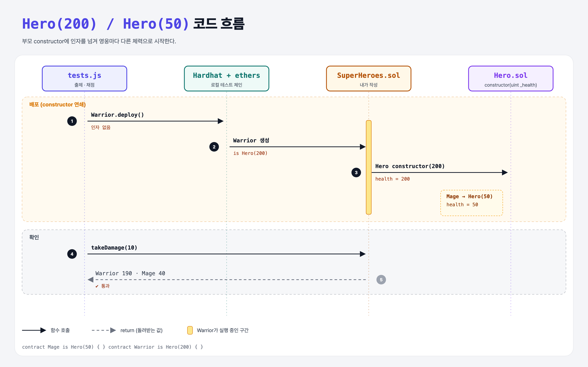

# Constructor Inheritance (Inheritance 2단계)

## 문제

`Hero`에 `constructor(uint _health)`가 생겼다.

1. `Warrior`는 체력 **200**으로 시작한다.
2. `Mage`는 체력 **50**으로 시작한다.

## 한 줄 요약

`contract Warrior is Hero(200) { }` — 상속하는 자리에서 부모 constructor의 인자를 넘긴다.



---

## 0. 이 과제가 말하려는 것

> **부모 constructor에 인자가 있으면, 자식이 반드시 값을 정해 줘야 한다.**

| 방법 | 코드 | 언제 |
|------|------|------|
| 상속 목록에서 | `contract Warrior is Hero(200) { }` | 값이 항상 같을 때 (이번 문제) |
| 자식 constructor에서 | `constructor() Hero(200) { }` | 자식 constructor 인자로 값을 계산할 때 |

```python
class Warrior(Hero):
    def __init__(self):
        super().__init__(200)
```

---

## 1. 파일 구성

| 파일 | 역할 |
|------|------|
| `Hero.sol` | 부모 컨트랙트 (constructor 추가됨) |
| `SuperHeroes.sol` | **이번에 완성할 파일** |
| `tests.js` | 출제 · 채점 (테스트 4개) |

---

## 2. 정답 코드

```solidity
contract Mage is Hero(50) { }

contract Warrior is Hero(200) { }
```

---

## 3. 테스트 한 줄씩

```js
warrior = await Warrior.deploy();          // 배포할 때 인자를 주지 않는다
assert.equal(health.toNumber(), 200);      // 200은 컨트랙트 코드 안에서 정해짐
await warrior.takeDamage(10);  // → 190
// Mage: 50 → 40
```

---

## 4. 일부러 틀려 보면

| 바꾼 것 | 결과 |
|---------|------|
| `contract Warrior is Hero { }` (인자 없음) | 컴파일 에러 `Contract "Warrior" should be marked as abstract.` — 부모 constructor 인자를 채우지 않으면 완성되지 않은(abstract) 컨트랙트로 본다 |

---

## 5. 실행 방법

```bash
sh tools/sol-test.sh week6/inherit-constructor
```

## 로컬 실행 환경 메모

강의 사이트는 브라우저 안에서 Hardhat으로 컴파일·테스트한다. 로컬에서는 루트의 Hardhat(ethers v5)으로 똑같이 돌린다: `sh tools/sol-test.sh <폴더>`.

## 기억할 것

1. `is Hero(200)` = Python의 `super().__init__(200)`.
2. 인자를 안 넘기면 abstract 취급 → 배포 불가.
