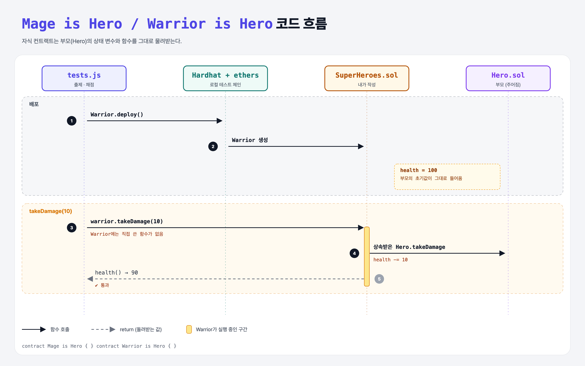

# Make SuperHeroes (Inheritance 1단계)

## 문제

`Hero` 컨트랙트(체력 100, `takeDamage`)가 주어진다.

1. `SuperHeroes.sol`에 `Mage`와 `Warrior` 컨트랙트를 만든다.
2. 둘 다 `Hero`를 **상속**해서 체력과 `takeDamage`를 그대로 쓰게 한다.

## 한 줄 요약

`contract Mage is Hero { }` — `is` 한 단어로 부모의 변수와 함수가 전부 따라온다.



---

## 0. 이 과제가 말하려는 것

> **상속(inheritance): 공통 코드는 부모 컨트랙트에 한 번만 쓰고, 자식은 `is`로 물려받는다.**

```
heroes → constructor → override → super → ownable → multiple
```

| Solidity | Python |
|----------|--------|
| `contract Warrior is Hero { }` | `class Warrior(Hero): pass` |
| 부모의 `health`, `takeDamage` 사용 | 부모의 속성·메서드 사용 |

---

## 1. 파일 구성

| 파일 | 역할 |
|------|------|
| `Hero.sol` | 부모 컨트랙트 (주어짐) |
| `SuperHeroes.sol` | **이번에 완성할 파일** |
| `tests.js` | 출제 · 채점 (테스트 4개) |

---

## 2. 정답 코드

```solidity
import "./Hero.sol";

contract Mage is Hero { }

contract Warrior is Hero { }
```

배포하면 `Warrior` 하나 안에 `Hero`의 코드가 합쳐져서 컴파일된다. 컨트랙트가 두 개 생기는 게 아니다.

---

## 3. 테스트 한 줄씩

```js
const Warrior = await ethers.getContractFactory("Warrior");
warrior = await Warrior.deploy();
assert.equal((await warrior.health()).toNumber(), 100);   // 부모의 초기값
await warrior.takeDamage(10);                              // 부모의 함수
assert.equal((await warrior.health()).toNumber(), 90);
```

---

## 5. 실행 방법

```bash
sh tools/sol-test.sh week6/inherit-heroes
```

## 로컬 실행 환경 메모

강의 사이트는 브라우저 안에서 Hardhat으로 컴파일·테스트한다. 로컬에서는 루트의 Hardhat(ethers v5)으로 똑같이 돌린다: `sh tools/sol-test.sh <폴더>`.

## 기억할 것

1. `is 부모` = Python의 `class 자식(부모)`.
2. 자식에 아무것도 안 써도 부모 기능을 전부 쓸 수 있다.
