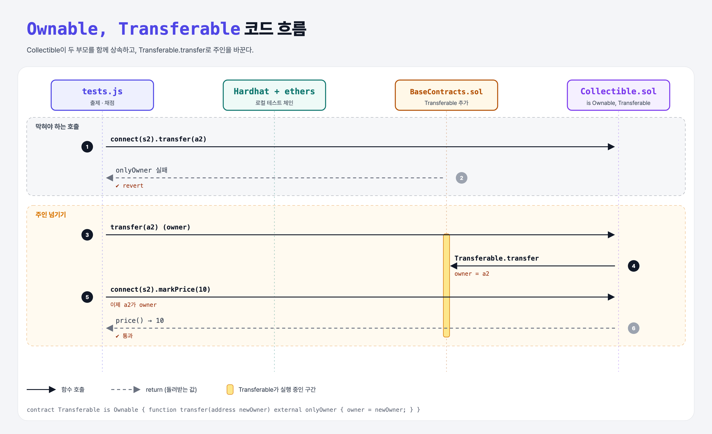

# Multiple Inheritance (Inheritance 6단계)

## 문제

`Collectible is Ownable, Transferable`로 바뀌었다. `Transferable`은 아직 없다.

1. `Transferable` 컨트랙트에 `transfer(address newOwner)`를 만든다.
2. 현재 owner만 호출할 수 있고, 호출하면 owner가 newOwner로 바뀐다.

## 한 줄 요약

`contract Transferable is Ownable { function transfer(address newOwner) external onlyOwner { owner = newOwner; } }`



---

## 0. 이 과제가 말하려는 것

> **여러 부모를 쉼표로 나열해서 상속할 수 있다. 순서는 "가장 기본 → 가장 파생".**

```
Ownable  ←  Transferable
   ↖           ↖
      Collectible  (is Ownable, Transferable)
```

- `Transferable`이 `owner`와 `onlyOwner`를 쓰려면 자신도 `Ownable`을 상속해야 한다.
- 그래도 `owner` 변수는 하나뿐이다. Solidity가 상속 그래프를 한 줄로 펴서(linearization) 같은 부모를 한 번만 넣는다. Python의 MRO와 같은 개념.

---

## 1. 파일 구성

| 파일 | 역할 |
|------|------|
| `BaseContracts.sol` | **Transferable 추가** |
| `Collectible.sol` | is Ownable, Transferable (주어짐) |
| `tests.js` | 출제 · 채점 (테스트 4개) |

---

## 2. 정답 코드

```solidity
contract Transferable is Ownable {
    function transfer(address newOwner) external onlyOwner {
        owner = newOwner;
    }
}
```

---

## 3. 테스트 한 줄씩

```js
await contract.connect(s2).transfer(a2);       // owner가 아님 → 에러
await contract.transfer(a2);                   // owner가 a2에게 넘김
await contract.connect(s2).markPrice(10);      // 이제 a2가 owner → 성공
```

---

## 4. 일부러 틀려 보면

| 바꾼 것 | 결과 |
|---------|------|
| `is Transferable, Ownable` (순서 반대) | 컴파일 에러 `Linearization of inheritance graph impossible` — 더 기본인 Ownable이 앞에 와야 한다 |

---

## 5. 실행 방법

```bash
sh tools/sol-test.sh week6/inherit-multiple
```

## 로컬 실행 환경 메모

강의 사이트는 브라우저 안에서 Hardhat으로 컴파일·테스트한다. 로컬에서는 루트의 Hardhat(ethers v5)으로 똑같이 돌린다: `sh tools/sol-test.sh <폴더>`.

## 기억할 것

1. 다중 상속은 기본 → 파생 순서로.
2. 같은 부모는 한 번만 들어간다 (linearization).
