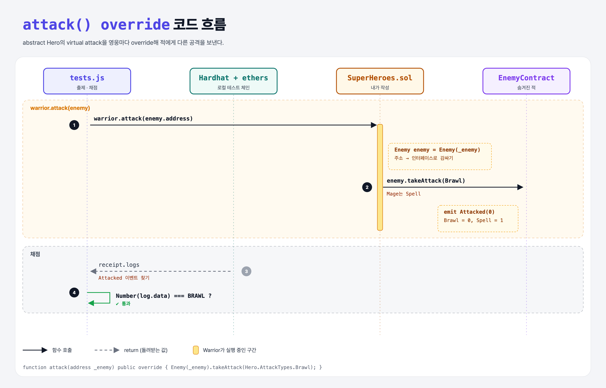

# Virtual Override (Inheritance 3단계)

## 문제

`Hero`가 `abstract` 컨트랙트가 되었고, 몸체가 없는 `function attack(address enemy) public virtual;`이 생겼다.

1. `Warrior`와 `Mage`에 `attack`을 `override`로 구현한다.
2. 받은 주소를 `Enemy` 인터페이스로 감싸서 `takeAttack`을 부른다.
3. Warrior는 `Brawl`, Mage는 `Spell` 공격.

## 한 줄 요약

`function attack(address _enemy) public override { Enemy(_enemy).takeAttack(Hero.AttackTypes.Brawl); }`



---

## 0. 이 과제가 말하려는 것

> **`virtual` = 자식이 다시 써도 됨. `override` = 지금 부모 함수를 다시 쓰는 중. 둘 다 적어야 한다.**

| 키워드 | 붙는 곳 | 의미 |
|--------|---------|------|
| `abstract contract` | 부모 | 몸체 없는 함수가 있어 혼자서는 배포 불가 |
| `virtual` | 부모 함수 | 자식이 바꿀 수 있음 |
| `override` | 자식 함수 | 부모 함수를 바꿈 |

Python은 그냥 같은 이름으로 다시 정의하면 끝이지만, Solidity는 실수를 막으려고 양쪽에 표시를 요구한다.

`Enemy(_enemy)`: 주소를 인터페이스 타입으로 바꾸면 그 주소의 컨트랙트 함수를 부를 수 있다. 실제 적 컨트랙트 코드는 몰라도 된다.

---

## 1. 파일 구성

| 파일 | 역할 |
|------|------|
| `Hero.sol` | abstract 부모 + `Enemy` 인터페이스 (주어짐) |
| `SuperHeroes.sol` | **이번에 완성할 파일** |
| `EnemyContract.sol` | 로컬 실행용 적 컨트랙트 (사이트에선 숨겨짐) |
| `tests.js` | 출제 · 채점 (테스트 2개) |

---

## 2. 정답 코드

```solidity
contract Mage is Hero(50) {
    function attack(address _enemy) public override {
        Enemy enemy = Enemy(_enemy);
        enemy.takeAttack(Hero.AttackTypes.Spell);
    }
}

contract Warrior is Hero(200) {
    function attack(address _enemy) public override {
        Enemy enemy = Enemy(_enemy);
        enemy.takeAttack(Hero.AttackTypes.Brawl);
    }
}
```

`AttackTypes`는 `Hero` 안에 정의된 enum이라 `Hero.AttackTypes.Brawl`로 쓴다 (상속받았으니 `AttackTypes.Brawl`도 된다).

---

## 3. 테스트 한 줄씩

```js
const tx = await warrior.attack(enemy.address);
receipt = await tx.wait();
const topic = Enemy.interface.getEventTopic("Attacked");   // 적이 남긴 이벤트
const log = receipt.logs.find(x => x.topics[0] === topic);
assert.equal(Number(log.data), ATTACK_TYPES.BRAWL);        // Brawl = 0, Spell = 1
```

---

## 4. 일부러 틀려 보면

| 바꾼 것 | 결과 |
|---------|------|
| `override` 빼기 | 컴파일 에러 `Overriding function is missing "override" specifier.` |
| `public` → `external` | 컴파일 에러 `Overriding function visibility differs.` — 부모와 visibility가 같아야 한다 |

---

## 5. 실행 방법

```bash
sh tools/sol-test.sh week6/inherit-override
```

## 로컬 실행 환경 메모

강의 사이트는 브라우저 안에서 Hardhat으로 컴파일·테스트한다. 로컬에서는 루트의 Hardhat(ethers v5)으로 똑같이 돌린다: `sh tools/sol-test.sh <폴더>`.

사이트에는 테스트용 컨트랙트(`EnemyContract`)가 숨겨져 있어서, 로컬 실행용으로 같은 역할을 하는 파일을 직접 만들어 두었다.

## 기억할 것

1. 부모 `virtual`, 자식 `override` — 둘 다 필요.
2. `인터페이스(주소)`로 다른 컨트랙트 함수 호출.
