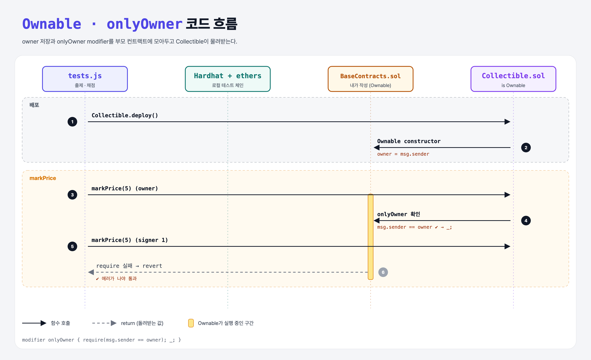

# Only Owner (Inheritance 5단계)

## 문제

`Collectible is Ownable`이고, `markPrice`에 `onlyOwner`가 붙어 있다. 그런데 `Ownable`이 비어 있다.

1. `Ownable`에 owner(배포자)를 저장한다.
2. `onlyOwner` modifier를 만들어 owner만 `markPrice`를 부를 수 있게 한다.

## 한 줄 요약

`Ownable`에 `owner = msg.sender` constructor와 `modifier onlyOwner { require(msg.sender == owner); _; }`.



---

## 0. 이 과제가 말하려는 것

> **권한 확인 같은 공통 기능은 부모 컨트랙트(유틸리티)로 빼 두고 여러 컨트랙트가 물려받는다.**

- 실무에서는 OpenZeppelin의 `Ownable`을 그대로 import해서 쓴다. 이번 문제는 그걸 직접 만들어 보는 것.
- 부모 constructor는 자식을 배포할 때 자동으로 실행된다. 그래서 `owner`는 Collectible을 배포한 사람이 된다.

---

## 1. 파일 구성

| 파일 | 역할 |
|------|------|
| `BaseContracts.sol` | **이번에 완성할 파일** (Ownable) |
| `Collectible.sol` | Ownable을 쓰는 쪽 (주어짐) |
| `tests.js` | 출제 · 채점 (테스트 2개) |

---

## 2. 정답 코드

```solidity
contract Ownable {
    address owner;

    constructor() {
        owner = msg.sender;
    }

    modifier onlyOwner {
        require(msg.sender == owner, "Only the owner can call this");
        _;
    }
}
```

---

## 3. 테스트 한 줄씩

```js
await contract.markPrice(5);                                       // 계정 0 = 배포자 → 성공
await contract.connect(ethers.provider.getSigner(1)).markPrice(5); // 계정 1 → 에러가 나야 통과
```

---

## 5. 실행 방법

```bash
sh tools/sol-test.sh week6/inherit-ownable
```

## 로컬 실행 환경 메모

강의 사이트는 브라우저 안에서 Hardhat으로 컴파일·테스트한다. 로컬에서는 루트의 Hardhat(ethers v5)으로 똑같이 돌린다: `sh tools/sol-test.sh <폴더>`.

## 기억할 것

1. modifier도 상속된다.
2. 부모 constructor는 자식 배포 때 자동 실행.
