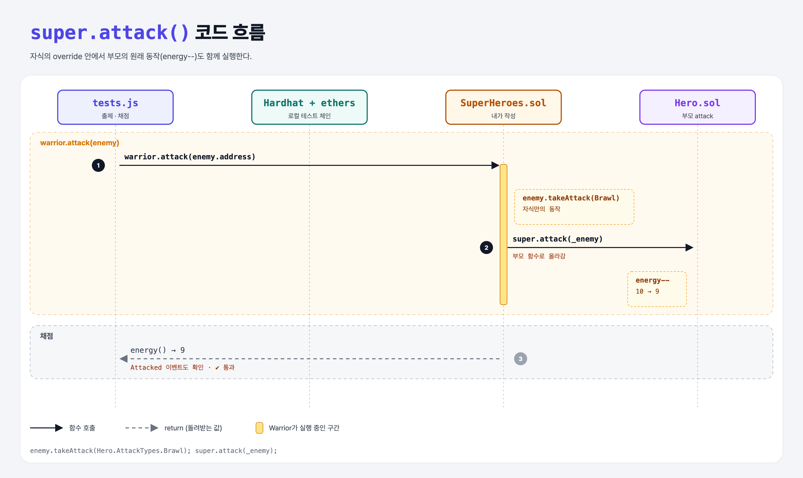

# Super Call (Inheritance 4단계)

## 문제

이제 `Hero.attack`에 몸체가 생겼다: `energy--` (처음 energy는 10).

Warrior와 Mage의 `attack`에서 부모의 `attack`도 함께 실행되게 한다.

## 한 줄 요약

자식 `attack` 끝에 `super.attack(_enemy);` 한 줄.



---

## 0. 이 과제가 말하려는 것

> **override하면 부모 함수는 자동으로 실행되지 않는다. 부모 동작도 원하면 `super`로 직접 불러야 한다.**

```python
class Warrior(Hero):
    def attack(self, enemy):
        enemy.take_attack(BRAWL)
        super().attack(enemy)
```

`super.attack(...)` 대신 `Hero.attack(...)`도 된다. 다중 상속에서는 `super`가 상속 순서를 따라 다음 부모를 찾아간다.

---

## 1. 파일 구성

| 파일 | 역할 |
|------|------|
| `Hero.sol` | 부모 (`attack`이 energy를 줄임) |
| `SuperHeroes.sol` | **이번에 완성할 파일** |
| `EnemyContract.sol` | 로컬 실행용 적 컨트랙트 |
| `tests.js` | 출제 · 채점 (테스트 4개) |

---

## 2. 정답 코드

```solidity
contract Warrior is Hero(200) {
    function attack(address _enemy) public override {
        Enemy enemy = Enemy(_enemy);
        enemy.takeAttack(Hero.AttackTypes.Brawl);
        super.attack(_enemy);
    }
}
// Mage도 같은 모양, Spell
```

---

## 3. 테스트 한 줄씩

```js
it('should use some energy', async () => {
    const energy = await warrior.energy();
    assert.equal(energy, 9);     // 10 → 9 (BigNumber와 9를 ==로 비교해서 통과)
});
```

---

## 4. 일부러 틀려 보면

| 바꾼 것 | 결과 |
|---------|------|
| `super.attack(_enemy);` 빼기 | 공격 이벤트 테스트는 통과하지만 `expected BigNumber { value: "10" } to equal 9` → energy 테스트 2개 실패 |

---

## 5. 실행 방법

```bash
sh tools/sol-test.sh week6/inherit-super
```

## 로컬 실행 환경 메모

강의 사이트는 브라우저 안에서 Hardhat으로 컴파일·테스트한다. 로컬에서는 루트의 Hardhat(ethers v5)으로 똑같이 돌린다: `sh tools/sol-test.sh <폴더>`.

사이트에는 테스트용 컨트랙트(`EnemyContract`)가 숨겨져 있어서, 로컬 실행용으로 같은 역할을 하는 파일을 직접 만들어 두었다.

## 기억할 것

1. override하면 부모 함수는 실행되지 않는다.
2. `super.함수()` = Python의 `super().함수()`.
