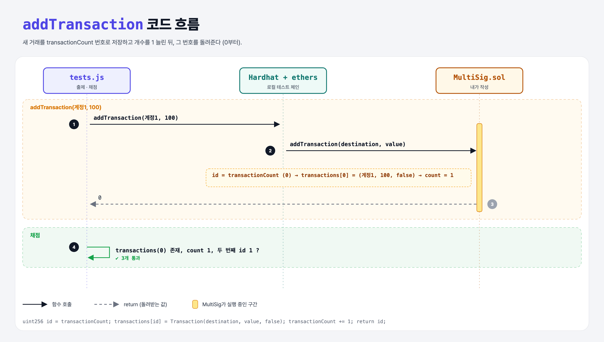

# Add Transaction (Multi-Signature Wallet 4단계)

## 문제

public `addTransaction(address destination, uint256 value)`: 새 거래를 저장하고 그 **거래 번호**(0부터)를 돌려준다. executed는 false로 시작.

## 한 줄 요약

`id = transactionCount` → 저장 → `transactionCount += 1` → `return id`.



---

## 0. 이 과제가 말하려는 것

첫 거래는 #0이 되고 count는 1, 다음 거래는 #1이 되고 count는 2.

---

## 1. 파일 구성

| 파일 | 역할 |
|------|------|
| `MultiSig.sol` | **addTransaction** |
| `tests.js` | 출제 · 채점 (테스트 3개) |

---

## 2. 정답 코드

```solidity
function addTransaction(address destination, uint256 value) public returns(uint256) {
    uint256 transactionId = transactionCount;
    transactions[transactionId] = Transaction(destination, value, false);
    transactionCount += 1;
    return transactionId;
}
```

---

## 3. 테스트 한 줄씩

```js
await contract.addTransaction(accounts[1], 100);
let txId = await contract.callStatic.addTransaction(accounts[1], 100);   // 실행하면 무엇을 돌려줄지만 확인
assert.equal(txId.toNumber(), 1);
```

강의 원본의 첫 테스트는 `contract.callStatic.transactions;`(괄호 없이 함수 자체)를 받아 `tx[0]`이 항상 `undefined`라서 무조건 통과한다. 로컬에서는 `transactions(0)`으로 실제로 읽도록 고쳤다.

---

## 5. 실행 방법

```bash
sh tools/sol-test.sh week6/multisig-add-transaction
```

## 로컬 실행 환경 메모

강의 사이트는 브라우저 안에서 Hardhat으로 컴파일·테스트한다. 로컬에서는 루트의 Hardhat(ethers v5)으로 똑같이 돌린다: `sh tools/sol-test.sh <폴더>`.

이 과제는 한 컨트랙트를 13단계에 걸쳐 키워 가서, 단계마다 이전 단계 코드에 무엇을 더했는지 `tools/multisig_stage.py`로 만들었다.

## 기억할 것

1. 거래 번호는 0부터, 카운터는 저장 후 증가.
