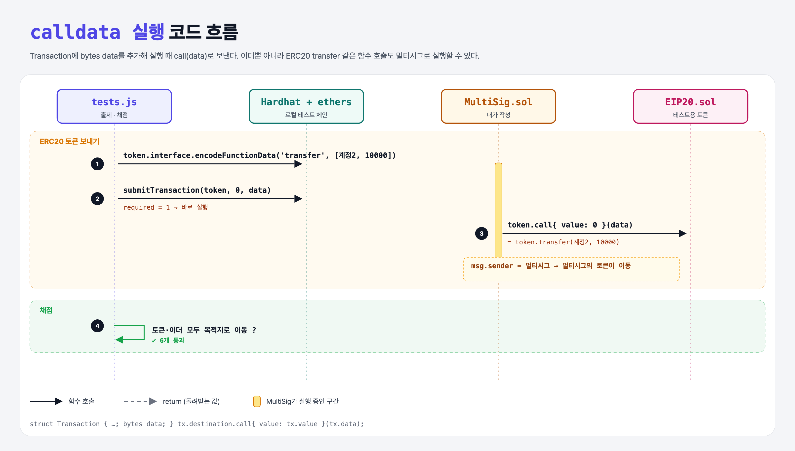

# Sending Calldata (Multi-Signature Wallet 13단계)

## 문제

1. `Transaction`의 마지막 필드로 `bytes data` 추가.
2. `addTransaction`, `submitTransaction`이 bytes 인자를 받아 전달.
3. 실행할 때 `destination.call{ value: value }(data)`로 data를 보낸다.

## 한 줄 요약

calldata까지 저장해 두면 **이더 송금뿐 아니라 어떤 함수 호출이든** 멀티시그 승인으로 실행할 수 있다.



---

## 0. 이 과제가 말하려는 것

> **ERC20 토큰을 멀티시그에서 보내려면 토큰 컨트랙트의 `transfer(to, amount)`를 "멀티시그가" 호출해야 한다. 그 호출 내용(calldata)을 거래에 저장해 두었다가 승인되면 실행한다.**

- 이더만 보낼 때는 data를 `"0x"`(빈 값)로.
- 4주차 pass-calldata 과제(calldata 전달)의 응용이다.

---

## 1. 파일 구성

| 파일 | 역할 |
|------|------|
| `MultiSig.sol` | **bytes data** 추가 |
| `EIP20.sol` | 테스트용 토큰 (사이트에서는 숨겨진 파일, 로컬에서 같은 모양으로 작성) |
| `tests.js` | 출제 · 채점 (테스트 6개) |

---

## 2. 정답 코드

```solidity
struct Transaction {
    address destination;
    uint256 value;
    bool executed;
    bytes data;
}

function addTransaction(address destination, uint256 value, bytes memory data) internal returns(uint256) {
    ...
    transactions[transactionId] = Transaction(destination, value, false, data);
    ...
}

function submitTransaction(address destination, uint value, bytes memory data) external {
    uint256 transactionId = addTransaction(destination, value, data);
    confirmTransaction(transactionId);
}

// executeTransaction 안에서
(bool success, ) = transaction.destination.call{ value: transaction.value }(transaction.data);
```

---

## 3. 테스트 한 줄씩

```js
contract = await MultiSig.deploy(accounts.slice(0, 3), 1);    // required 1 → submit하면 바로 실행
token = await EIP20.deploy(10000, 'My Token', 1, 'MT');
await token.transfer(contract.address, 10000);                 // 멀티시그에 토큰 입금
const data = token.interface.encodeFunctionData("transfer", [accounts[2], 10000]);
await contract.submitTransaction(token.address, 0, data);      // 멀티시그가 token.transfer 호출
assert.equal((await token.balanceOf(accounts[2])).toNumber(), 10000);
await contract.submitTransaction(accounts[1], oneEther, "0x"); // 이더 송금은 빈 data
```

---

## 5. 실행 방법

```bash
sh tools/sol-test.sh week6/multisig-calldata
```

## 로컬 실행 환경 메모

강의 사이트는 브라우저 안에서 Hardhat으로 컴파일·테스트한다. 로컬에서는 루트의 Hardhat(ethers v5)으로 똑같이 돌린다: `sh tools/sol-test.sh <폴더>`.

이 과제는 한 컨트랙트를 13단계에 걸쳐 키워 가서, 단계마다 이전 단계 코드에 무엇을 더했는지 `tools/multisig_stage.py`로 만들었다.

`EIP20`은 강의 사이트에서 숨겨진 테스트용 토큰이다. 로컬에서는 생성자(초기 수량, 이름, 소수점, 기호)와 `transfer`, `balanceOf`만 같은 모양으로 직접 만들었다.

## 기억할 것

1. 거래 = 목적지 + 이더 + calldata.
2. calldata로 어떤 함수든 실행 가능 → 승인 대상이 '돈'에서 '행동'으로 넓어진다.
