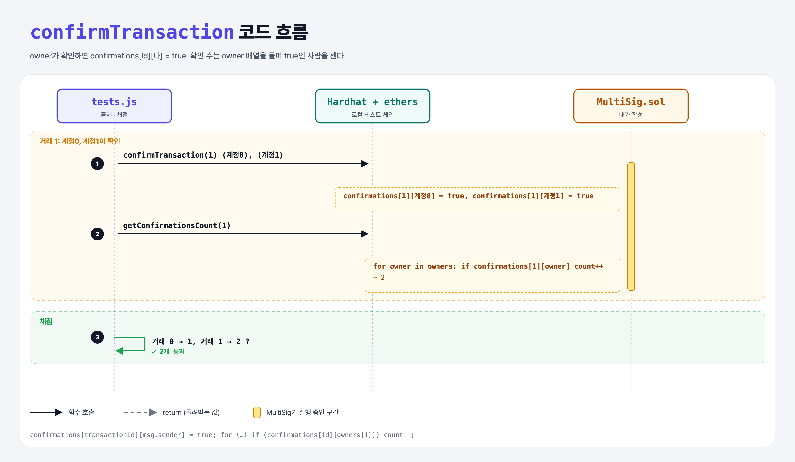

# Owner Confirmations (Multi-Signature Wallet 6단계)

## 문제

1. public `confirmTransaction(transactionId)`: msg.sender의 확인을 기록.
2. public view `getConfirmationsCount(transactionId)`: 확인 수를 돌려준다.

## 한 줄 요약

확인은 `confirmations[id][msg.sender] = true`. 개수는 **owner 배열을 돌며** true인 사람을 센다.



---

## 0. 이 과제가 말하려는 것

mapping은 키 목록을 돌 수 없다. 그래서 "누가 확인했나"를 세려면 확인할 수 있는 사람(owners) 배열을 돌아야 한다.

---

## 1. 파일 구성

| 파일 | 역할 |
|------|------|
| `MultiSig.sol` | **confirmTransaction, getConfirmationsCount** |
| `tests.js` | 출제 · 채점 (테스트 2개) |

---

## 2. 정답 코드

```solidity
function confirmTransaction(uint256 transactionId) public {
    confirmations[transactionId][msg.sender] = true;
}

function getConfirmationsCount(uint transactionId) public view returns(uint256) {
    uint256 count;
    for (uint i = 0; i < owners.length; i++) {
        if (confirmations[transactionId][owners[i]]) {
            count++;
        }
    }
    return count;
}
```

---

## 3. 테스트 한 줄씩

```js
await contract.confirmTransaction(1);                                                   // 계정 0
await contract.connect(ethers.provider.getSigner(accounts[1])).confirmTransaction(1);  // 계정 1
assert.equal(await contract.callStatic.getConfirmationsCount(1), 2);
```

---

## 5. 실행 방법

```bash
sh tools/sol-test.sh week6/multisig-confirm
```

## 로컬 실행 환경 메모

강의 사이트는 브라우저 안에서 Hardhat으로 컴파일·테스트한다. 로컬에서는 루트의 Hardhat(ethers v5)으로 똑같이 돌린다: `sh tools/sol-test.sh <폴더>`.

이 과제는 한 컨트랙트를 13단계에 걸쳐 키워 가서, 단계마다 이전 단계 코드에 무엇을 더했는지 `tools/multisig_stage.py`로 만들었다.

## 기억할 것

1. mapping은 순회 불가 → 확인 가능한 사람 배열을 돈다.
