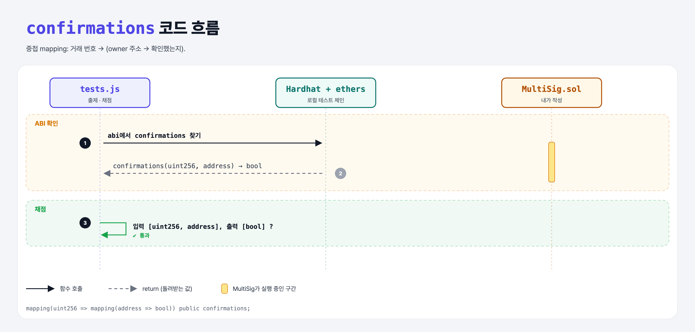

# Confirmations Storage (Multi-Signature Wallet 5단계)

## 문제

public 중첩 mapping `confirmations`: 거래 번호(uint) → owner 주소 → 확인 여부(bool).

## 한 줄 요약

`mapping(uint256 => mapping(address => bool)) public confirmations;`



---

## 0. 이 과제가 말하려는 것

거래마다 누가 확인했는지를 기록하는 표.

---

## 1. 파일 구성

| 파일 | 역할 |
|------|------|
| `MultiSig.sol` | **confirmations** |
| `tests.js` | 출제 · 채점 (테스트 1개) — ABI만 확인 |

---

## 2. 정답 코드

```solidity
mapping(uint256 => mapping(address => bool)) public confirmations;
```

---

## 3. 테스트 한 줄씩

```js
assert.deepEqual(confirmations.inputs.map(x => x.type), ['uint256', 'address']);   // 중첩 mapping getter는 키 2개
assert.deepEqual(confirmations.outputs.map(x => x.type), ['bool']);
```

---

## 5. 실행 방법

```bash
sh tools/sol-test.sh week6/multisig-confirmations
```

## 로컬 실행 환경 메모

강의 사이트는 브라우저 안에서 Hardhat으로 컴파일·테스트한다. 로컬에서는 루트의 Hardhat(ethers v5)으로 똑같이 돌린다: `sh tools/sol-test.sh <폴더>`.

이 과제는 한 컨트랙트를 13단계에 걸쳐 키워 가서, 단계마다 이전 단계 코드에 무엇을 더했는지 `tools/multisig_stage.py`로 만들었다.

강의 테스트는 `./artifacts/contracts/MultiSig.sol/MultiSig.json` 파일을 직접 읽는다. 로컬은 컴파일 결과 위치가 달라서 `hre.artifacts.readArtifact("MultiSig")`로 같은 ABI를 읽도록 바꿨다.

## 기억할 것

1. 중첩 mapping getter = 키를 차례로 인자로.
