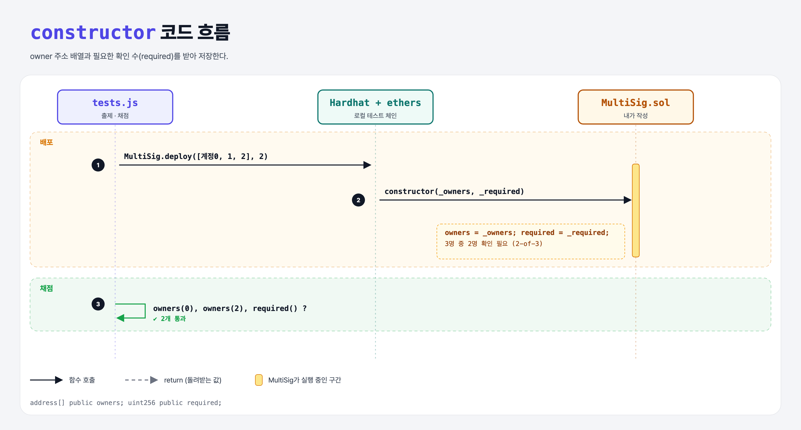

# Constructor (Multi-Signature Wallet 1단계)

## 문제

1. public `address[] owners`: 지갑 주인들.
2. public `uint256 required`: 거래 실행에 필요한 확인 수.
3. constructor: owner 주소 배열과 required를 받아 저장.

## 한 줄 요약

`owners = _owners; required = _required;` — 예: 3명 중 2명이 확인해야 돈이 나가는 지갑 (2-of-3).



---

## 0. 이 과제가 말하려는 것

> **멀티시그 지갑 = 여러 명의 서명(확인)이 모여야 돈이 나가는 스마트 컨트랙트 지갑. 개인키 하나를 잃어버리거나 도둑맞아도 돈이 안전하다.**

- 일반 계정(EOA)은 개인키 하나가 곧 모든 권한이라 **단일 실패 지점**이다.
- 쓰임새: 회사 자금, 가족 공동 지출, DAO 금고. 실제 서비스로는 Gnosis Safe(Safe)가 있다.

```
constructor → 입력 검사 → Transaction 저장소 → addTransaction → confirmations → confirm
→ owner만 → submit → receive → isConfirmed → execute → 즉시 실행 → calldata
```

---

## 1. 파일 구성

| 파일 | 역할 |
|------|------|
| `MultiSig.sol` | **이번에 완성할 컨트랙트** |
| `tests.js` | 출제 · 채점 (테스트 2개) |

---

## 2. 정답 코드

```solidity
address[] public owners;
uint256 public required;

constructor(address[] memory _owners, uint256 _required) {
    owners = _owners;
    required = _required;
}
```

- 배열 인자는 `memory`. memory 배열을 storage 상태 변수에 대입하면 **복사**된다.

---

## 3. 테스트 한 줄씩

```js
contract = await MultiSig.deploy(accounts.slice(0, 3), 2);   // 계정 0, 1, 2가 owner
assert.equal(accounts[2], await contract.callStatic.owners(2));
```

---

## 5. 실행 방법

```bash
sh tools/sol-test.sh week6/multisig-constructor
```

## 로컬 실행 환경 메모

강의 사이트는 브라우저 안에서 Hardhat으로 컴파일·테스트한다. 로컬에서는 루트의 Hardhat(ethers v5)으로 똑같이 돌린다: `sh tools/sol-test.sh <폴더>`.

이 과제는 한 컨트랙트를 13단계에 걸쳐 키워 가서, 단계마다 이전 단계 코드에 무엇을 더했는지 `tools/multisig_stage.py`로 만들었다.

## 기억할 것

1. 멀티시그 = M-of-N 확인이 있어야 실행되는 지갑.
