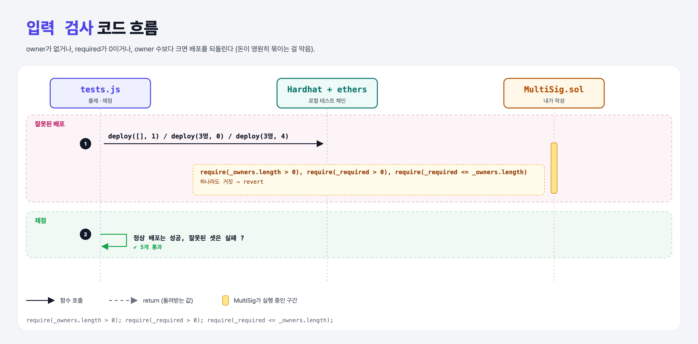

# Error Handling (Multi-Signature Wallet 2단계)

## 문제

배포할 때 다음 경우 revert: owner가 없음 / required가 0 / required가 owner 수보다 큼.

## 한 줄 요약

constructor 맨 앞에 `require` 세 개.



---

## 0. 이 과제가 말하려는 것

> **잘못 배포된 멀티시그는 돈이 영원히 묶일 수 있다. (예: required가 owner 수보다 크면 절대 실행 불가)**

사용자 입력은 처음에 검사한다.

---

## 1. 파일 구성

| 파일 | 역할 |
|------|------|
| `MultiSig.sol` | constructor에 **require 3개** |
| `tests.js` | 출제 · 채점 (테스트 5개) |

---

## 2. 정답 코드

```solidity
constructor(address[] memory _owners, uint256 _required) {
    require(_owners.length > 0, "No owners");
    require(_required > 0, "Required must be at least 1");
    require(_required <= _owners.length, "Required exceeds owner count");
    owners = _owners;
    required = _required;
}
```

---

## 3. 테스트 한 줄씩

```js
await expectThrow(MultiSig.deploy([], 1));
await expectThrow(MultiSig.deploy(accounts.slice(0,3), 0));
await expectThrow(MultiSig.deploy(accounts.slice(0,3), 4));
```

---

## 5. 실행 방법

```bash
sh tools/sol-test.sh week6/multisig-errors
```

## 로컬 실행 환경 메모

강의 사이트는 브라우저 안에서 Hardhat으로 컴파일·테스트한다. 로컬에서는 루트의 Hardhat(ethers v5)으로 똑같이 돌린다: `sh tools/sol-test.sh <폴더>`.

이 과제는 한 컨트랙트를 13단계에 걸쳐 키워 가서, 단계마다 이전 단계 코드에 무엇을 더했는지 `tools/multisig_stage.py`로 만들었다.

## 기억할 것

1. 입력 검사는 constructor 맨 앞에서.
