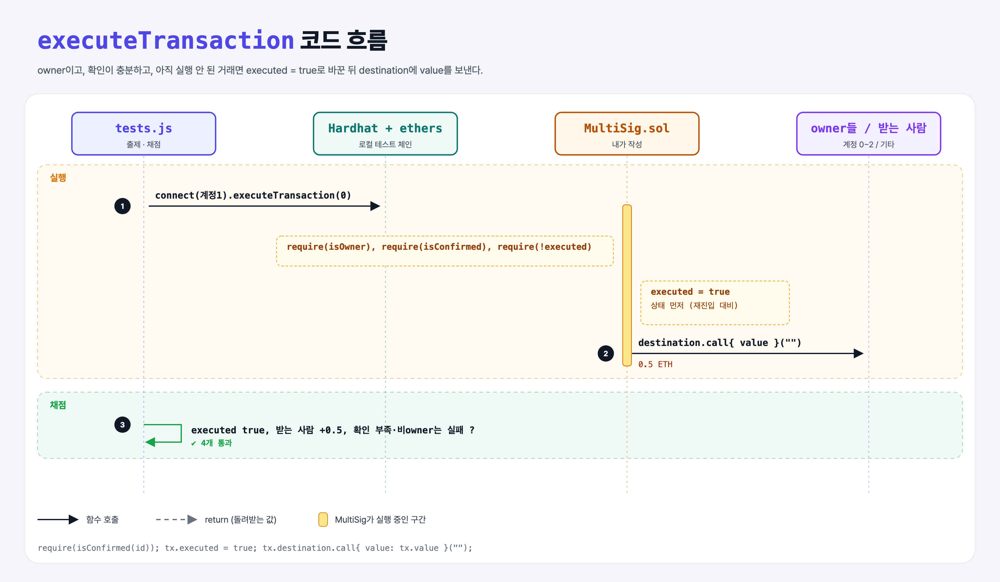

# Execute (Multi-Signature Wallet 11단계)

## 문제

public `executeTransaction(transactionId)`:
1. 거래의 value를 destination에 보낸다.
2. 보낸 뒤 executed를 true로.
3. 🔒 확인이 충분하지 않으면 revert.

## 한 줄 요약

검사(owner, 확인 충분, 미실행) → `executed = true` → `call{ value }`.



---

## 0. 이 과제가 말하려는 것

- 강의 조건은 "보낸 뒤 executed = true"지만, **상태를 먼저 바꾸고 보내는** 게 안전하다 (Checks-Effects-Interactions). 받는 쪽이 컨트랙트라면 송금 중에 다시 execute를 불러 두 번 받으려 할 수 있다(재진입). `require(!executed)`와 순서가 이걸 막는다.
- 테스트의 "owner만 실행" 조건도 만족하도록 owner 확인을 넣었다.

---

## 1. 파일 구성

| 파일 | 역할 |
|------|------|
| `MultiSig.sol` | **executeTransaction** |
| `tests.js` | 출제 · 채점 (테스트 4개) |

---

## 2. 정답 코드

```solidity
function executeTransaction(uint transactionId) public {
    require(isOwner(msg.sender), "Only owners can execute");
    require(isConfirmed(transactionId), "Not enough confirmations");
    Transaction storage transaction = transactions[transactionId];
    require(!transaction.executed, "Already executed");

    transaction.executed = true;
    (bool success, ) = transaction.destination.call{ value: transaction.value }("");
    require(success, "Transfer failed");
}
```

---

## 3. 테스트 한 줄씩

```js
await signer1.sendTransaction({ to: contract.address, value });       // 1 ETH 입금
await contract.submitTransaction(recipient, transferValue);            // 0.5 ETH 제안 (확인 1)
await contract.connect(signer1).confirmTransaction(0);                 // 확인 2
await contract.connect(signer1).executeTransaction(0);
assert.equal(balanceAfter.sub(balanceBefore).toString(), transferValue.toString());
```

---

## 5. 실행 방법

```bash
sh tools/sol-test.sh week6/multisig-execute
```

## 로컬 실행 환경 메모

강의 사이트는 브라우저 안에서 Hardhat으로 컴파일·테스트한다. 로컬에서는 루트의 Hardhat(ethers v5)으로 똑같이 돌린다: `sh tools/sol-test.sh <폴더>`.

이 과제는 한 컨트랙트를 13단계에 걸쳐 키워 가서, 단계마다 이전 단계 코드에 무엇을 더했는지 `tools/multisig_stage.py`로 만들었다.

## 기억할 것

1. 검사 → 상태 변경 → 송금.
2. `Transaction storage tx = …`로 원본 수정.
