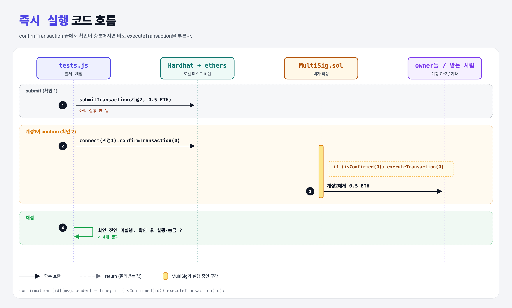

# Immediate Execution (Multi-Signature Wallet 12단계)

## 문제

`confirmTransaction` 안에서, 확인이 충분해지면 바로 `executeTransaction`을 부르기.

## 한 줄 요약

`if (isConfirmed(id)) executeTransaction(id);`



---

## 0. 이 과제가 말하려는 것

마지막 확인자가 실행을 위해 거래를 또 보낼 필요가 없다.

---

## 1. 파일 구성

| 파일 | 역할 |
|------|------|
| `MultiSig.sol` | confirmTransaction에 **자동 실행** |
| `tests.js` | 출제 · 채점 (테스트 4개) |

---

## 2. 정답 코드

```solidity
function confirmTransaction(uint256 transactionId) public {
    require(isOwner(msg.sender), "Only owners can confirm");
    confirmations[transactionId][msg.sender] = true;
    if (isConfirmed(transactionId)) {
        executeTransaction(transactionId);
    }
}
```

- 이미 실행된 거래를 또 확인하면 `executeTransaction`의 `require(!executed)` 때문에 revert된다. 그래서 확인 수가 required를 넘는 경우는 생기지 않는다.

---

## 3. 테스트 한 줄씩

```js
await signer1.sendTransaction({ to: contract.address, value: transferAmount.mul(2) });   // 1 ETH (화면에서 잘린 부분은 짐작)
await contract.submitTransaction(accounts[2], transferAmount);   // 확인 1 → 아직 실행 안 됨
await contract.connect(signer1).confirmTransaction(0);           // 확인 2 → 바로 실행
assert(txn.executed);
```

---

## 5. 실행 방법

```bash
sh tools/sol-test.sh week6/multisig-immediate
```

## 로컬 실행 환경 메모

강의 사이트는 브라우저 안에서 Hardhat으로 컴파일·테스트한다. 로컬에서는 루트의 Hardhat(ethers v5)으로 똑같이 돌린다: `sh tools/sol-test.sh <폴더>`.

이 과제는 한 컨트랙트를 13단계에 걸쳐 키워 가서, 단계마다 이전 단계 코드에 무엇을 더했는지 `tools/multisig_stage.py`로 만들었다.

화면에서 잘려 보이지 않은 입금액은 `transferAmount.mul(2)`로 짐작했다 (0.5 ETH 이상이면 결과는 같다).

## 기억할 것

1. 조건이 충족되는 순간 자동 실행.
