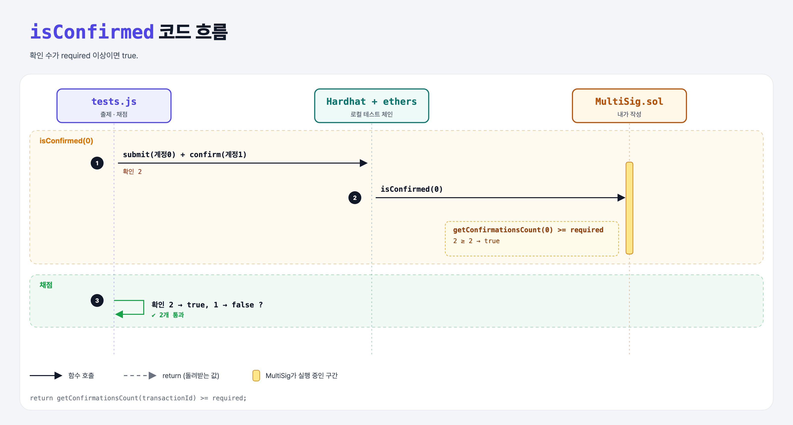

# Check if Confirmed (Multi-Signature Wallet 10단계)

## 문제

public view `isConfirmed(transactionId)`: 확인이 충분하면 true.

## 한 줄 요약

`return getConfirmationsCount(transactionId) >= required;`



---

## 0. 이 과제가 말하려는 것

실행 전에 쓸 판단 함수. 이미 만든 `getConfirmationsCount`를 재사용한다.

---

## 1. 파일 구성

| 파일 | 역할 |
|------|------|
| `MultiSig.sol` | **isConfirmed** |
| `tests.js` | 출제 · 채점 (테스트 2개) |

---

## 2. 정답 코드

```solidity
function isConfirmed(uint transactionId) public view returns(bool) {
    return getConfirmationsCount(transactionId) >= required;
}
```

---

## 3. 테스트 한 줄씩

```js
await contract.submitTransaction(accounts[1], 100);                                       // 확인 1 (계정 0)
await contract.connect(ethers.provider.getSigner(accounts[1])).confirmTransaction(0);    // 확인 2
assert.equal(await contract.callStatic.isConfirmed(0), true);
```

---

## 5. 실행 방법

```bash
sh tools/sol-test.sh week6/multisig-is-confirmed
```

## 로컬 실행 환경 메모

강의 사이트는 브라우저 안에서 Hardhat으로 컴파일·테스트한다. 로컬에서는 루트의 Hardhat(ethers v5)으로 똑같이 돌린다: `sh tools/sol-test.sh <폴더>`.

이 과제는 한 컨트랙트를 13단계에 걸쳐 키워 가서, 단계마다 이전 단계 코드에 무엇을 더했는지 `tools/multisig_stage.py`로 만들었다.

## 기억할 것

1. `>=` (정확히 required여도 충분).
