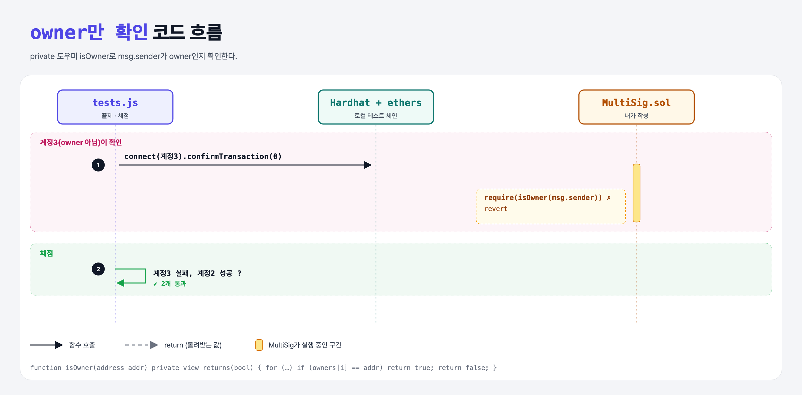

# Only Owners (Multi-Signature Wallet 7단계)

## 문제

owner가 아닌 사람이 `confirmTransaction`을 부르면 revert.

## 한 줄 요약

private `isOwner` 도우미 + `require(isOwner(msg.sender))`.



---

## 0. 이 과제가 말하려는 것

아무나 확인할 수 있으면 멀티시그의 의미가 없다.

---

## 1. 파일 구성

| 파일 | 역할 |
|------|------|
| `MultiSig.sol` | **isOwner, 권한 확인** |
| `tests.js` | 출제 · 채점 (테스트 2개) |

---

## 2. 정답 코드

```solidity
function isOwner(address addr) private view returns(bool) {
    for (uint i = 0; i < owners.length; i++) {
        if (owners[i] == addr) return true;
    }
    return false;
}

function confirmTransaction(uint256 transactionId) public {
    require(isOwner(msg.sender), "Only owners can confirm");
    confirmations[transactionId][msg.sender] = true;
}
```

`private`: 이 컨트랙트 안에서만 쓰는 도우미 (상속받은 컨트랙트도 못 씀).

---

## 3. 테스트 한 줄씩

```js
await expectThrow(contract.connect(ethers.provider.getSigner(accounts[3])).confirmTransaction(0));   // 계정 3은 owner 아님
await contract.connect(ethers.provider.getSigner(accounts[2])).confirmTransaction(0);              // 성공
```

---

## 5. 실행 방법

```bash
sh tools/sol-test.sh week6/multisig-only-owners
```

## 로컬 실행 환경 메모

강의 사이트는 브라우저 안에서 Hardhat으로 컴파일·테스트한다. 로컬에서는 루트의 Hardhat(ethers v5)으로 똑같이 돌린다: `sh tools/sol-test.sh <폴더>`.

이 과제는 한 컨트랙트를 13단계에 걸쳐 키워 가서, 단계마다 이전 단계 코드에 무엇을 더했는지 `tools/multisig_stage.py`로 만들었다.

## 기억할 것

1. 반복되는 검사는 도우미 함수로.
