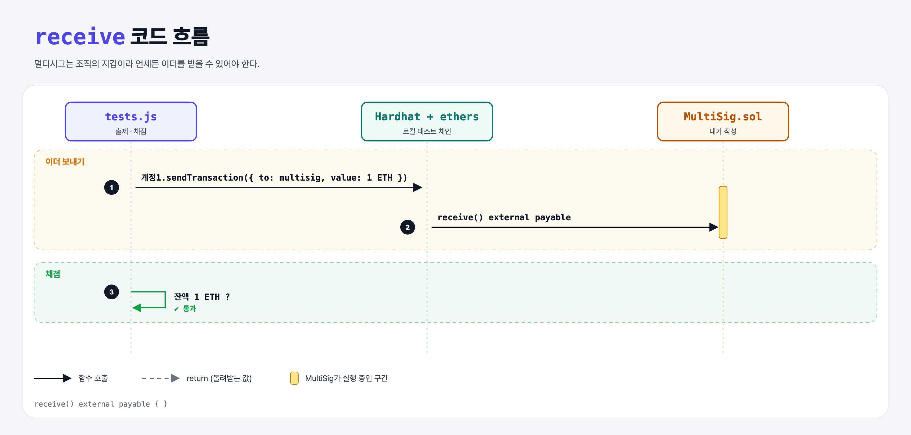

# Receive (Multi-Signature Wallet 9단계)

## 문제

언제든 이더를 받을 수 있게 external payable `receive` 함수 정의.

## 한 줄 요약

`receive() external payable { }`



---

## 0. 이 과제가 말하려는 것

조직이 모든 입금을 멀티시그 주소로 받게 할 수 있다.

---

## 1. 파일 구성

| 파일 | 역할 |
|------|------|
| `MultiSig.sol` | **receive** |
| `tests.js` | 출제 · 채점 (테스트 1개) |

---

## 2. 정답 코드

```solidity
receive() external payable { }
```

---

## 3. 테스트 한 줄씩

```js
await ethers.provider.getSigner(accounts[1]).sendTransaction({ to: contract.address, value });
assert.equal((await ethers.provider.getBalance(contract.address)).toString(), value.toString());
```

---

## 5. 실행 방법

```bash
sh tools/sol-test.sh week6/multisig-receive
```

## 로컬 실행 환경 메모

강의 사이트는 브라우저 안에서 Hardhat으로 컴파일·테스트한다. 로컬에서는 루트의 Hardhat(ethers v5)으로 똑같이 돌린다: `sh tools/sol-test.sh <폴더>`.

이 과제는 한 컨트랙트를 13단계에 걸쳐 키워 가서, 단계마다 이전 단계 코드에 무엇을 더했는지 `tools/multisig_stage.py`로 만들었다.

## 기억할 것

1. 그냥 송금을 받으려면 receive.
