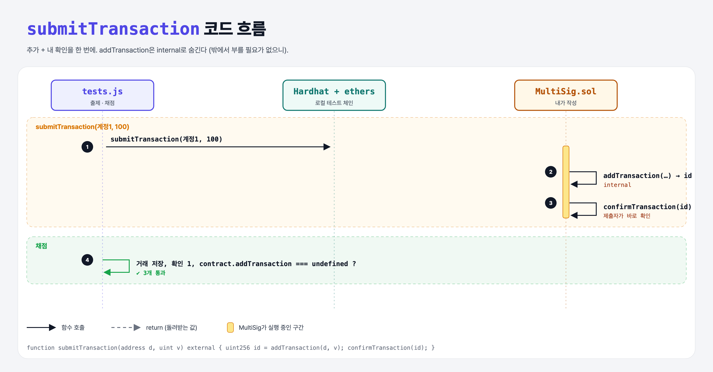

# Submit Transactions (Multi-Signature Wallet 8단계)

## 문제

1. external `submitTransaction(destination, value)`: 거래를 추가하고 **바로 확인**까지 한다.
2. `addTransaction`을 public → **internal**로 바꾼다.

## 한 줄 요약

제출하는 owner는 당연히 찬성이니 두 번의 거래를 한 번으로 줄인다. 밖에서 부를 필요 없는 함수는 숨긴다.



---

## 0. 이 과제가 말하려는 것

공개 함수가 적을수록 공격받을 수 있는 입구가 줄어든다 (보안 원칙: 최소 노출).

---

## 1. 파일 구성

| 파일 | 역할 |
|------|------|
| `MultiSig.sol` | **submitTransaction**, addTransaction internal |
| `tests.js` | 출제 · 채점 (테스트 3개) |

---

## 2. 정답 코드

```solidity
function addTransaction(address destination, uint256 value) internal returns(uint256) { ... }

function submitTransaction(address destination, uint value) external {
    uint256 transactionId = addTransaction(destination, value);
    confirmTransaction(transactionId);
}
```

---

## 3. 테스트 한 줄씩

```js
assert.equal(contract.addTransaction, undefined, "...");   // internal이라 ABI에 없음 → ethers 객체에도 없음
```

---

## 5. 실행 방법

```bash
sh tools/sol-test.sh week6/multisig-submit
```

## 로컬 실행 환경 메모

강의 사이트는 브라우저 안에서 Hardhat으로 컴파일·테스트한다. 로컬에서는 루트의 Hardhat(ethers v5)으로 똑같이 돌린다: `sh tools/sol-test.sh <폴더>`.

이 과제는 한 컨트랙트를 13단계에 걸쳐 키워 가서, 단계마다 이전 단계 코드에 무엇을 더했는지 `tools/multisig_stage.py`로 만들었다.

화면에서 잘려 보이지 않은 assert 메시지 끝부분은 짐작으로 채웠다 (채점 결과와 무관).

## 기억할 것

1. internal = 밖에서 안 보임 (ABI에도 없음).
