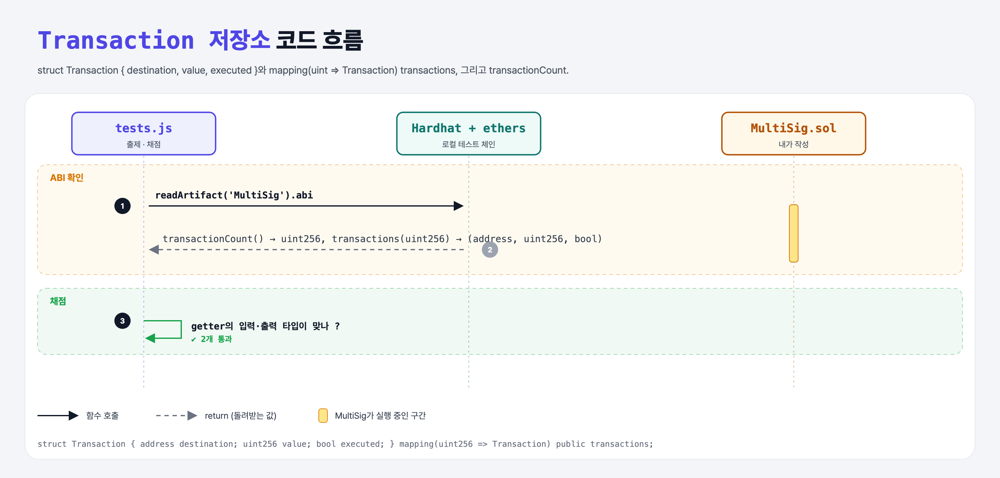

# Transaction Struct (Multi-Signature Wallet 3단계)

## 문제

1. struct `Transaction`: `address destination`, `uint256 value`, `bool executed` (이 순서).
2. 거래 저장소: public mapping(uint → Transaction) 또는 public 배열 `transactions`.
3. 저장된 거래 수를 돌려주는 public `transactionCount`.

## 한 줄 요약

`mapping(uint256 => Transaction) public transactions;` + `uint256 public transactionCount;`



---

## 0. 이 과제가 말하려는 것

한 owner가 거래를 제안하면, 다른 owner들이 확인할 때까지 컨트랙트가 거래 정보를 보관해야 한다.

```
constructor → 입력 검사 → Transaction 저장소 → addTransaction → confirmations → confirm
→ owner만 → submit → receive → isConfirmed → execute → 즉시 실행 → calldata
```

---

## 1. 파일 구성

| 파일 | 역할 |
|------|------|
| `MultiSig.sol` | **Transaction, transactions, transactionCount** |
| `tests.js` | 출제 · 채점 (테스트 2개) — ABI만 확인 |

---

## 2. 정답 코드

```solidity
uint256 public transactionCount;

struct Transaction {
    address destination;
    uint256 value;
    bool executed;
}

mapping(uint256 => Transaction) public transactions;
```

mapping을 고른 이유: 번호로 바로 찾고, 개수는 transactionCount가 따로 센다.

---

## 3. 테스트 한 줄씩

```js
const transactions = abi.filter(x => x.name === 'transactions')[0];
assert.deepEqual(transactions.inputs.map(x => x.type), ['uint256']);
assert.deepEqual(transactions.outputs.map(x => x.type), ['address', 'uint256', 'bool']);   // struct 필드 순서대로
```

---

## 5. 실행 방법

```bash
sh tools/sol-test.sh week6/multisig-transactions
```

## 로컬 실행 환경 메모

강의 사이트는 브라우저 안에서 Hardhat으로 컴파일·테스트한다. 로컬에서는 루트의 Hardhat(ethers v5)으로 똑같이 돌린다: `sh tools/sol-test.sh <폴더>`.

이 과제는 한 컨트랙트를 13단계에 걸쳐 키워 가서, 단계마다 이전 단계 코드에 무엇을 더했는지 `tools/multisig_stage.py`로 만들었다.

강의 테스트는 `./artifacts/contracts/MultiSig.sol/MultiSig.json` 파일을 직접 읽는다. 로컬은 컴파일 결과 위치가 달라서 `hre.artifacts.readArtifact("MultiSig")`로 같은 ABI를 읽도록 바꿨다.

## 기억할 것

1. public struct mapping의 getter는 필드들을 순서대로 돌려준다.
