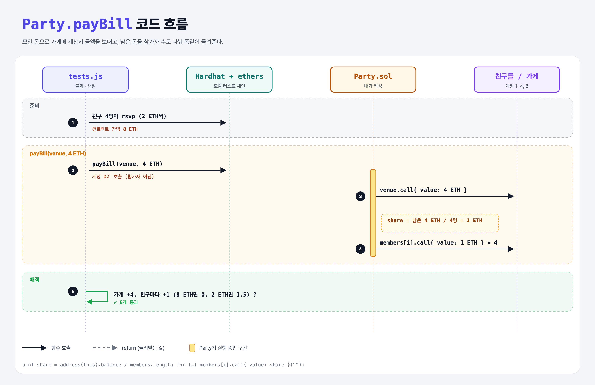

# Pay the Bill (Party Split 2단계)

## 문제

external 함수 `payBill(address venue, uint amount)`:

1. 모인 돈으로 가게(venue)에 `amount`를 보낸다 (돈은 충분하다고 가정).
2. 남은 돈을 참가자들에게 **똑같이** 나눠 돌려준다.

## 한 줄 요약

`venue.call{ value: amount }` → `share = address(this).balance / members.length` → 참가자마다 `share` 송금.



---

## 0. 이 과제가 말하려는 것

| 계산서 | 참가비 합계 (4명 × 2 ETH) | 남는 돈 | 1인당 환불 |
|--------|---------------------------|---------|-----------|
| 8 ETH | 8 | 0 | 0 |
| 4 ETH | 8 | 4 | 1 |
| 2 ETH | 8 | 6 | 1.5 |

- 실제 서비스라면 `payBill`을 아무나 부르지 못하게 막아야 한다 (이 문제는 조건에 없음).
- 참가자가 많으면 반복문 송금은 가스 한도를 넘을 수 있다. 실무에서는 각자 찾아가게 하는 **pull 방식**을 쓴다.

---

## 1. 파일 구성

| 파일 | 역할 |
|------|------|
| `Party.sol` | party-rsvp + **payBill** |
| `tests.js` | 출제 · 채점 (테스트 6개) |

---

## 2. 정답 코드

```solidity
function payBill(address venue, uint amount) external {
    (bool paid, ) = venue.call{ value: amount }("");
    require(paid, "Failed to pay the venue");

    uint share = address(this).balance / members.length;
    for (uint i = 0; i < members.length; i++) {
        (bool sent, ) = members[i].call{ value: share }("");
        require(sent, "Failed to refund");
    }
}
```

---

## 3. 테스트 한 줄씩

```js
const signers = await ethers.getSigners();
friends = signers.slice(1, 5);       // 계정 1~4가 참가
venue = signers[6];
await contract.payBill(venue.address, bill);   // 계정 0이 호출 → 친구들은 가스를 안 내서 잔액 비교가 정확함
const expected = previousBalances[i].add(parseEther("1")).toString();
```

---

## 5. 실행 방법

```bash
sh tools/sol-test.sh week6/party-pay-bill
```

## 로컬 실행 환경 메모

강의 사이트는 브라우저 안에서 Hardhat으로 컴파일·테스트한다. 로컬에서는 루트의 Hardhat(ethers v5)으로 똑같이 돌린다: `sh tools/sol-test.sh <폴더>`.

## 기억할 것

1. 남은 돈 = `address(this).balance`.
2. 반복 송금은 인원이 많으면 위험 → pull 방식.
