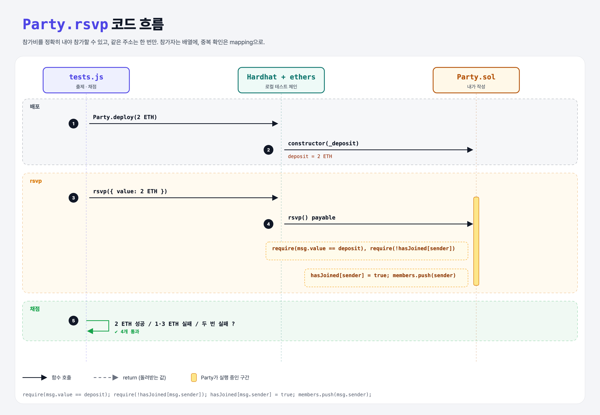

# Start a Party (Party Split 1단계)

## 문제

친구들과 비용을 나눠 내는 파티 컨트랙트.

1. **constructor**: 참가비(`uint256`)를 받아 저장한다.
2. **rsvp** (external, payable): 호출한 주소를 참가자로 기록한다.
3. 🔒 참가비와 **정확히 같은** 금액이 아니면 revert. 이미 참가한 주소가 다시 부르면 revert.

## 한 줄 요약

참가자 목록은 **배열**(나중에 돌면서 환불), 중복 확인은 **mapping**(빠른 조회). 둘을 함께 쓴다.



---

## 0. 이 과제가 말하려는 것

> **Solidity Challenges: 지금까지 배운 것(payable, require, 배열, mapping)을 조합하는 문제들.**

```
[rsvp] → payBill
 ★ 이 단계  party-pay-bill
```

| 자료구조 | 용도 | 이유 |
|----------|------|------|
| `address[] members` | 참가자 목록 | 나중에 한 명씩 환불하려면 순회가 필요 |
| `mapping(address => bool) hasJoined` | 중복 확인 | 배열을 매번 훑지 않고 O(1)로 확인 |

---

## 1. 파일 구성

| 파일 | 역할 |
|------|------|
| `Party.sol` | **이번에 완성할 컨트랙트** |
| `tests.js` | 출제 · 채점 (테스트 4개) |

---

## 2. 정답 코드

```solidity
uint256 public deposit;
address[] public members;
mapping(address => bool) public hasJoined;

constructor(uint256 _deposit) {
    deposit = _deposit;
}

function rsvp() external payable {
    require(msg.value == deposit, "Must pay exactly the deposit");
    require(!hasJoined[msg.sender], "Already RSVP'd");

    hasJoined[msg.sender] = true;
    members.push(msg.sender);
}
```

---

## 3. 테스트 한 줄씩

```js
contract = await Party.deploy(parseEther("2"));
await contract.connect(a1).rsvp({ value: deposit });                  // 성공
await contract.connect(a1).rsvp({ value: parseEther("1") });          // 에러가 나야 함
await contract.connect(a1).rsvp({ value: parseEther("3") });          // 에러 (더 많아도 안 됨)
// 같은 계정 두 번 → 에러
```

---

## 4. 일부러 틀려 보면

| 바꾼 것 | 결과 |
|---------|------|
| `msg.value >= deposit` | 3 ETH도 통과 → '더 많이 낸 경우' 테스트 실패 |

---

## 5. 실행 방법

```bash
sh tools/sol-test.sh week6/party-rsvp
```

## 로컬 실행 환경 메모

강의 사이트는 브라우저 안에서 Hardhat으로 컴파일·테스트한다. 로컬에서는 루트의 Hardhat(ethers v5)으로 똑같이 돌린다: `sh tools/sol-test.sh <폴더>`.

화면에서 잘려 보이지 않은 assert 메시지 끝부분은 짐작으로 채웠다 (채점 결과와 무관).

## 기억할 것

1. 순회가 필요하면 배열, 빠른 확인은 mapping.
2. 금액은 정확히 `==`.
