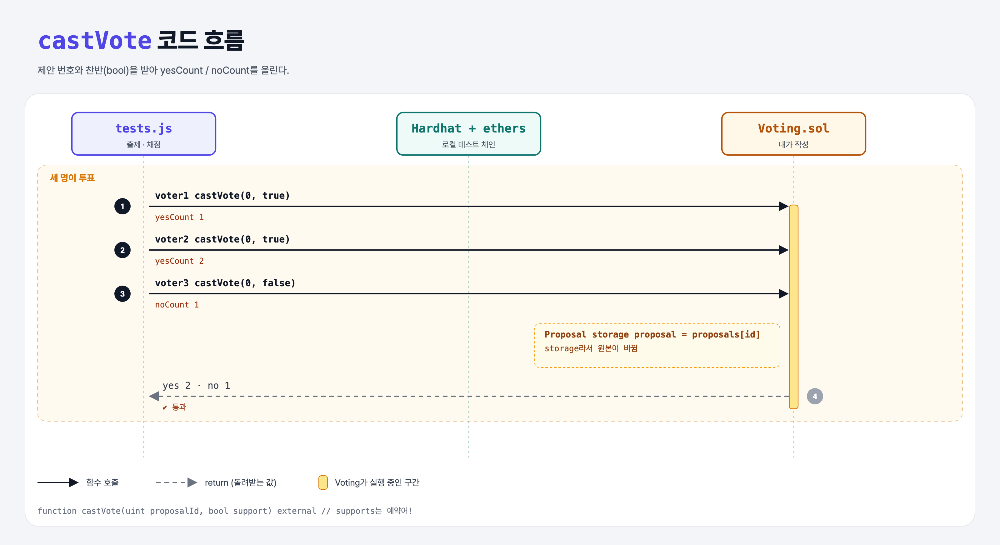

# Cast a Vote (Basic Governance 2단계)

## 문제

external `castVote(uint proposalId, bool)`: true면 yesCount, false면 noCount를 1 올린다. (중복 투표는 아직 신경 쓰지 않음)

## 한 줄 요약

`Proposal storage proposal = proposals[proposalId];` 후 `yesCount++` 또는 `noCount++`.



---

## 0. 이 과제가 말하려는 것

> **struct를 고칠 때는 `storage` 참조로 받아야 원본이 바뀐다.**

`Proposal memory p = proposals[id]`로 받으면 복사본을 고치는 것이라 저장되지 않는다. Python에는 없는 구분이라 주의.

---

## 1. 파일 구성

| 파일 | 역할 |
|------|------|
| `Voting.sol` | proposals + **castVote** |
| `tests.js` | 출제 · 채점 (테스트 2개) |

---

## 2. 정답 코드

```solidity
function castVote(uint proposalId, bool support) external {
    Proposal storage proposal = proposals[proposalId];
    if (support) {
        proposal.yesCount++;
    } else {
        proposal.noCount++;
    }
}
```

---

## 3. 테스트 한 줄씩

```js
await voting.connect(voter1).castVote(0, true);
await voting.connect(voter2).castVote(0, true);
await voting.connect(voter3).castVote(0, false);
// yesCount 2, noCount 1
```

---

## 4. 일부러 틀려 보면

| 바꾼 것 | 결과 |
|---------|------|
| 매개변수 이름을 `supports`로 | 컴파일 에러 `Expected ',' but got reserved keyword 'supports'` — Solidity 예약어라 변수 이름으로 못 쓴다 (사이트에서 실제로 겪은 에러) |

---

## 5. 실행 방법

```bash
sh tools/sol-test.sh week7/gov-cast-vote
```

## 로컬 실행 환경 메모

강의 사이트는 브라우저 안에서 Hardhat으로 컴파일·테스트한다. 로컬에서는 루트의 Hardhat(ethers v5)으로 똑같이 돌린다: `sh tools/sol-test.sh <폴더>`.

## 기억할 것

1. struct 수정은 `storage` 참조로.
2. `supports`는 예약어.
