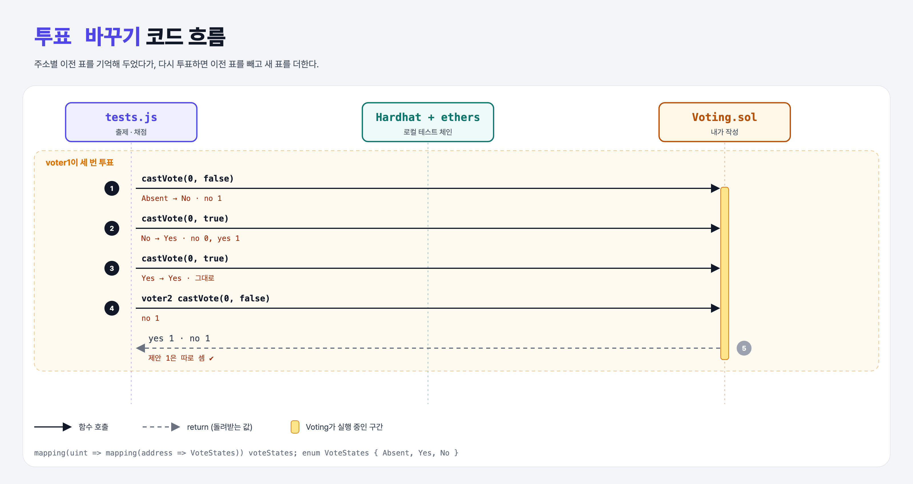

# Multiple Votes (Basic Governance 3단계)

## 문제

같은 주소가 다시 투표하면 표를 **바꿀** 수 있게 한다. 이전 표는 빼고 새 표를 더한다.

## 한 줄 요약

`enum VoteStates { Absent, Yes, No }` + `mapping(제안 → mapping(주소 → VoteStates))`로 이전 표를 기억.



---

## 0. 이 과제가 말하려는 것

> **"누가 무엇에 투표했는지"를 이중 mapping으로 기록한다.**

| voter1 행동 | 이전 상태 | yes / no |
|-------------|-----------|----------|
| false | Absent | 0 / 1 |
| true | No → 빼고 더함 | 1 / 0 |
| true | Yes → 빼고 더함 | 1 / 0 |

enum의 첫 값(`Absent`)이 기본값이라 "아직 안 함"을 자연스럽게 표현할 수 있다. bool 하나로는 "안 함 / 찬성 / 반대" 세 상태를 못 나타낸다.

---

## 1. 파일 구성

| 파일 | 역할 |
|------|------|
| `Voting.sol` | castVote 수정 + **VoteStates** |
| `tests.js` | 출제 · 채점 (테스트 4개) |

---

## 2. 정답 코드

```solidity
enum VoteStates { Absent, Yes, No }
mapping(uint => mapping(address => VoteStates)) voteStates;

function castVote(uint proposalId, bool support) external {
    Proposal storage proposal = proposals[proposalId];
    VoteStates previous = voteStates[proposalId][msg.sender];

    if (previous == VoteStates.Yes) {
        proposal.yesCount--;
    } else if (previous == VoteStates.No) {
        proposal.noCount--;
    }

    if (support) {
        proposal.yesCount++;
    } else {
        proposal.noCount++;
    }
    voteStates[proposalId][msg.sender] = support ? VoteStates.Yes : VoteStates.No;
}
```

---

## 3. 테스트 한 줄씩

```js
await contract.connect(voter1).castVote(0, false);
await contract.connect(voter1).castVote(0, true);
await contract.connect(voter1).castVote(0, true);
await contract.connect(voter2).castVote(0, false);
// yes 1, no 1 — 그리고 제안 1에서 voter1의 첫 투표는 따로 센다 (yes 1, no 0)
```

---

## 4. 일부러 틀려 보면

| 바꾼 것 | 결과 |
|---------|------|
| 마지막 `voteStates[...] = ...` 줄 빼기 | 이전 표를 기억하지 못해 매번 새 표로 더해짐 → `expected 2 to equal 1`로 2개 실패 |

---

## 5. 실행 방법

```bash
sh tools/sol-test.sh week7/gov-change-vote
```

## 로컬 실행 환경 메모

강의 사이트는 브라우저 안에서 Hardhat으로 컴파일·테스트한다. 로컬에서는 루트의 Hardhat(ethers v5)으로 똑같이 돌린다: `sh tools/sol-test.sh <폴더>`.

## 기억할 것

1. 세 가지 상태는 enum으로.
2. 제안별·주소별 기록 = 이중 mapping.
