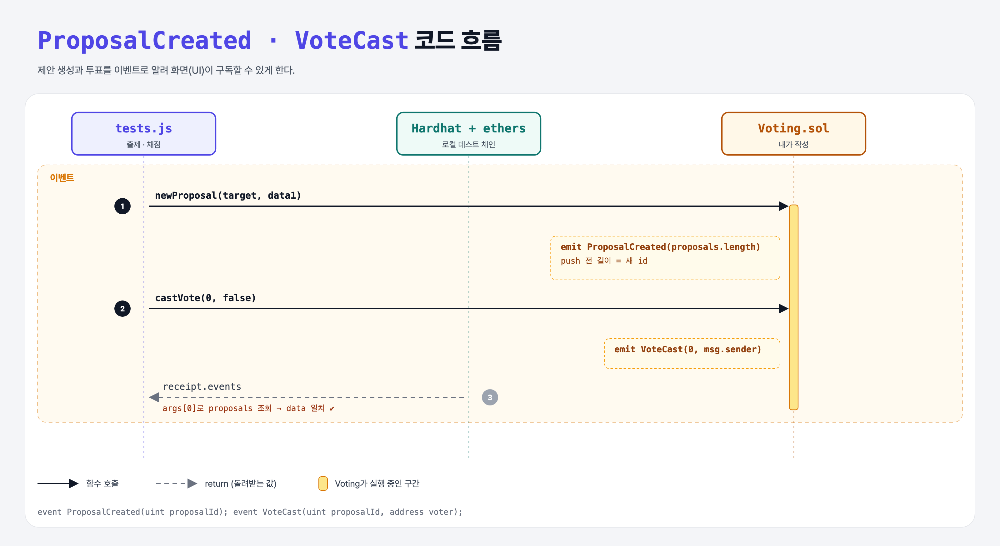

# Events (Basic Governance 4단계)

## 문제

1. `ProposalCreated(uint)`를 만들고 새 제안을 만들 때 emit한다.
2. `VoteCast(uint, address)`를 만들고 투표할 때마다 emit한다.

## 한 줄 요약

push 전에 `emit ProposalCreated(proposals.length);`, castVote 끝에 `emit VoteCast(proposalId, msg.sender);`.



---

## 0. 이 과제가 말하려는 것

> **화면(UI)은 이벤트를 구독해서 새 제안과 투표를 실시간으로 보여 준다.**

새 제안의 id = 배열에 들어갈 자리 = **push 하기 전의** `proposals.length`. push한 뒤라면 `proposals.length - 1`.

---

## 1. 파일 구성

| 파일 | 역할 |
|------|------|
| `Voting.sol` | **이벤트 2개 추가** |
| `tests.js` | 출제 · 채점 (테스트 5개) |

---

## 2. 정답 코드

```solidity
event ProposalCreated(uint proposalId);
event VoteCast(uint proposalId, address voter);

function newProposal(address target, bytes calldata data) external {
    emit ProposalCreated(proposals.length);
    proposals.push(Proposal(target, data, 0, 0));
}

// castVote 마지막 줄
emit VoteCast(proposalId, msg.sender);
```

---

## 3. 테스트 한 줄씩

```js
const tx = await (await contract.newProposal(target, data1)).wait();
event1 = tx.events.find(x => x.event === "ProposalCreated");
const proposal = await contract.proposals(event1.args[0]);   // 이벤트의 id로 찾은 제안
assert.equal(proposal.data, data1);
```

---

## 5. 실행 방법

```bash
sh tools/sol-test.sh week7/gov-events
```

## 로컬 실행 환경 메모

강의 사이트는 브라우저 안에서 Hardhat으로 컴파일·테스트한다. 로컬에서는 루트의 Hardhat(ethers v5)으로 똑같이 돌린다: `sh tools/sol-test.sh <폴더>`.

## 기억할 것

1. 새 id = push 전 length.
2. 이벤트 인자로 UI가 데이터를 다시 조회한다.
