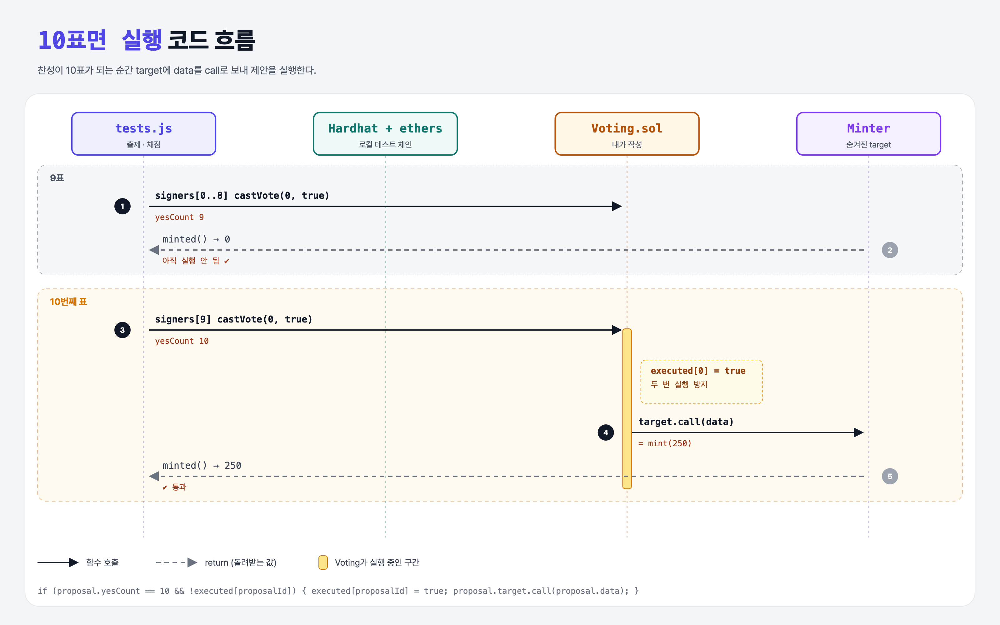

# Execute (Basic Governance 6단계)

## 문제

찬성이 **10표**가 되면 제안을 실행한다: `target`에 `data`를 call로 보낸다. 이미 실행한 제안은 다시 실행하지 않는다.

## 한 줄 요약

castVote 끝에서 `yesCount == 10 && !executed[id]`이면 `executed[id] = true` 후 `target.call(data)`.



---

## 0. 이 과제가 말하려는 것

> **투표 결과가 사람 손을 거치지 않고 코드로 바로 실행된다. 이게 온체인 거버넌스의 핵심.**

- `target.call(data)`: data 안의 함수 선택자와 인자대로 target 컨트랙트 함수를 부른다. 이번엔 `Minter.mint(250)`.
- `executed`를 call **전에** true로 바꾼다 (Checks-Effects-Interactions). call 도중 다시 들어와도 두 번 실행되지 않게.
- struct에 필드를 추가하지 않고 별도 mapping을 쓴 이유: struct를 바꾸면 `Proposal(target, data, 0, 0)` 생성 코드와 getter 모양도 같이 바뀌기 때문.

---

## 1. 파일 구성

| 파일 | 역할 |
|------|------|
| `Voting.sol` | **실행 로직 추가** |
| `Minter.sol` | 로컬 실행용 target (사이트에선 숨겨짐) |
| `test.js` | 출제 · 채점 (테스트 2개) |

---

## 2. 정답 코드

```solidity
mapping(uint => bool) executed;

// castVote 마지막
if (proposal.yesCount == 10 && !executed[proposalId]) {
    executed[proposalId] = true;
    (bool success, ) = proposal.target.call(proposal.data);
    require(success, "Execution failed");
}
```

---

## 3. 테스트 한 줄씩

```js
contract = await Voting.deploy(await Promise.all(signers.map(x => x.getAddress())));   // 20개 계정 모두 구성원
await contract.newProposal(minter.address, data);   // data = mint(250)
// 9명 찬성 → minted() 0
// 10번째 찬성 → minted() 250
```

---

## 5. 실행 방법

```bash
sh tools/sol-test.sh week7/gov-execute
```

## 로컬 실행 환경 메모

강의 사이트는 브라우저 안에서 Hardhat으로 컴파일·테스트한다. 로컬에서는 루트의 Hardhat(ethers v5)으로 똑같이 돌린다: `sh tools/sol-test.sh <폴더>`.

## 기억할 것

1. 실행 = `target.call(data)`.
2. 상태(executed)를 먼저 바꾸고 외부 호출.
