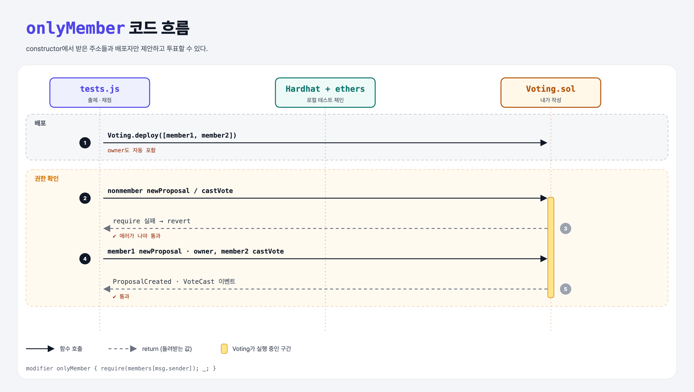

# Voting Members (Basic Governance 5단계)

## 문제

public constructor가 주소 배열을 받는다. 그 주소들과 **배포자**만 제안하고 투표할 수 있다. 다른 주소는 revert.

## 한 줄 요약

`mapping(address => bool) members`에 배포자와 배열 주소를 true로 저장하고 `onlyMember` modifier로 막는다.



---

## 0. 이 과제가 말하려는 것

> **아무나 투표할 수 있으면 주소를 수백 개 만들어 표를 늘릴 수 있다 (Sybil 공격). 그래서 구성원 명단이 필요하다.**

실제 DAO는 명단 대신 **토큰 보유량**으로 표의 무게를 정한다 (다음 가이드의 ERC20 Governor).

---

## 1. 파일 구성

| 파일 | 역할 |
|------|------|
| `Voting.sol` | **constructor + onlyMember** |
| `test.js` | 출제 · 채점 (테스트 5개) |

---

## 2. 정답 코드

```solidity
mapping(address => bool) members;

constructor(address[] memory _members) {
    members[msg.sender] = true;
    for (uint i = 0; i < _members.length; i++) {
        members[_members[i]] = true;
    }
}

modifier onlyMember {
    require(members[msg.sender], "Only members");
    _;
}

function newProposal(...) external onlyMember { ... }
function castVote(...) external onlyMember { ... }
```

배열 대신 mapping에 넣은 이유: 투표할 때마다 배열을 다 훑지 않고 바로 확인하려고.

---

## 3. 테스트 한 줄씩

```js
contract = await Voting.deploy([await member1.getAddress(), await member2.getAddress()]);
await contract.connect(nonmember).newProposal(target, data);   // 에러가 나야 통과
await contract.connect(owner).castVote(0, false);               // 배포자도 구성원
```

---

## 5. 실행 방법

```bash
sh tools/sol-test.sh week7/gov-members
```

## 로컬 실행 환경 메모

강의 사이트는 브라우저 안에서 Hardhat으로 컴파일·테스트한다. 로컬에서는 루트의 Hardhat(ethers v5)으로 똑같이 돌린다: `sh tools/sol-test.sh <폴더>`.

## 기억할 것

1. 배포자도 명단에 넣는다.
2. 명단 확인은 mapping으로 O(1).
