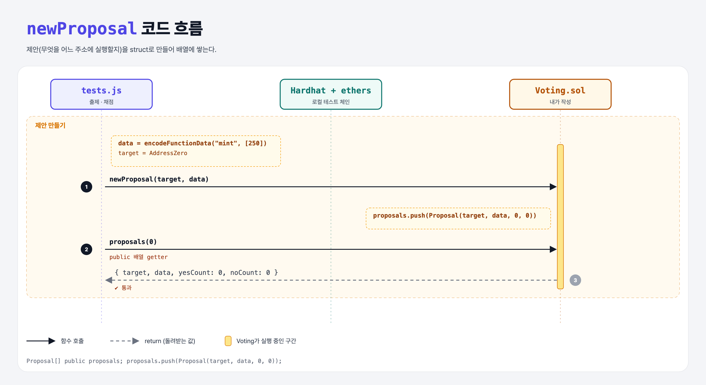

# Proposals (Basic Governance 1단계)

## 문제

1. `Proposal` struct(target, data, yesCount, noCount)의 public 배열 `proposals`를 만든다.
2. external `newProposal(address, bytes)`: 새 Proposal을 찬반 0표로 만들어 배열에 넣는다.

## 한 줄 요약

`proposals.push(Proposal(target, data, 0, 0));`



---

## 0. 이 과제가 말하려는 것

> **온체인 거버넌스: 구성원이 "이 주소에 이 함수 호출을 실행하자"를 제안하고 투표로 결정한다.**

```
proposals → cast-vote → change-vote → events → members → execute
```

| 필드 | 뜻 |
|------|----|
| `target` | 실행할 컨트랙트 주소 |
| `data` | 보낼 calldata (예: `mint(250)`을 인코딩한 바이트) |
| `yesCount` / `noCount` | 찬반 수 |

---

## 1. 파일 구성

| 파일 | 역할 |
|------|------|
| `Voting.sol` | **이번에 완성할 컨트랙트** (struct는 주어짐) |
| `tests.js` | 출제 · 채점 (테스트 4개) |

---

## 2. 정답 코드

```solidity
Proposal[] public proposals;

function newProposal(address target, bytes calldata data) external {
    proposals.push(Proposal(target, data, 0, 0));
}
```

---

## 3. 테스트 한 줄씩

```js
const interface = new ethers.utils.Interface(["function mint(uint) external"]);
const data = interface.encodeFunctionData("mint", [250]);   // 0x + 함수 선택자 4바이트 + 인자
await voting.newProposal(ethers.constants.AddressZero, data);
proposal = await voting.proposals(0);   // { target, data, yesCount, noCount }
```

---

## 5. 실행 방법

```bash
sh tools/sol-test.sh week7/gov-proposals
```

## 로컬 실행 환경 메모

강의 사이트는 브라우저 안에서 Hardhat으로 컴파일·테스트한다. 로컬에서는 루트의 Hardhat(ethers v5)으로 똑같이 돌린다: `sh tools/sol-test.sh <폴더>`.

## 기억할 것

1. 제안 = 실행할 주소 + calldata.
2. public 배열 getter는 인덱스로 하나씩 읽는다.
