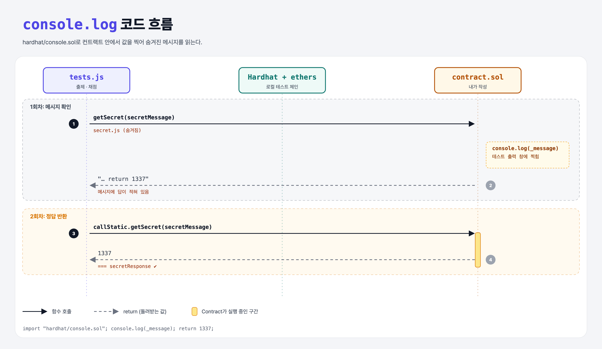

# Console Log (Libraries 3단계)

## 문제

`getSecret(string)`에 전달되는 메시지를 `console.log`로 찍어 보고, 메시지가 시키는 숫자를 return한다.

## 한 줄 요약

`console.log(_message);`로 메시지를 확인 → "return 1337" → `return 1337;`.



---

## 0. 이 과제가 말하려는 것

> **Hardhat의 `console.sol`로 컨트랙트 안에서도 `console.log` 디버깅을 할 수 있다.**

- `import "hardhat/console.sol";`만 하면 `console.log(uint | string | bool | address)`를 쓸 수 있다.
- 값은 Hardhat 로컬 체인 실행 결과(테스트 출력)에 찍힌다. 실제 메인넷에서는 아무것도 출력되지 않는다.
- 이 단계의 메시지는 숨겨진 `secret.js`에서 오므로, 직접 찍어 보는 것 말고는 답을 알 방법이 없게 설계되어 있다.

---

## 1. 파일 구성

| 파일 | 역할 |
|------|------|
| `contract.sol` | **이번에 완성할 컨트랙트** |
| `secret.js` | 로컬 실행용 비밀 메시지 (사이트에선 숨겨짐) |
| `tests.js` | 출제 · 채점 (테스트 1개) |

---

## 2. 정답 코드

```solidity
import "hardhat/console.sol";

contract Contract {
    function getSecret(string memory _message) public returns(uint) {
        console.log(_message);   // "Hello there! You found the secret message. To pass this stage return 1337"
        return 1337;
    }
}
```

---

## 3. 테스트 한 줄씩

```js
const { secretMessage, secretResponse } = require('./secret');   // 숨겨진 파일
const response = await contract.callStatic.getSecret(secretMessage);
assert(response.toNumber() === secretResponse);
```

---

## 5. 실행 방법

```bash
sh tools/sol-test.sh week7/library-console-log
```

## 로컬 실행 환경 메모

강의 사이트는 브라우저 안에서 Hardhat으로 컴파일·테스트한다. 로컬에서는 루트의 Hardhat(ethers v5)으로 똑같이 돌린다: `sh tools/sol-test.sh <폴더>`.

## 기억할 것

1. `import "hardhat/console.sol"` → `console.log`.
2. 로그는 Hardhat 로컬 실행에서만 보인다.
