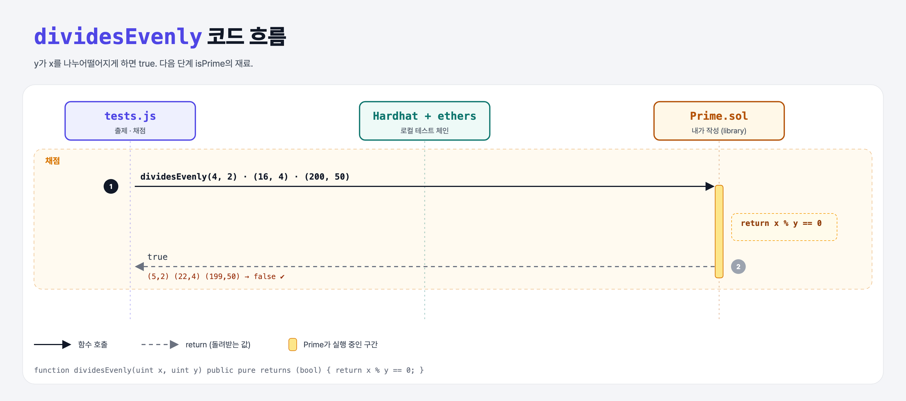

# Base Functions (Libraries 4단계)

## 문제

library `Prime`에 public pure `dividesEvenly(uint x, uint y)`: y가 x를 나누어떨어지게 하면 `true`.

## 한 줄 요약

`return x % y == 0;`



---

## 0. 이 과제가 말하려는 것

> **작은 기본 함수를 먼저 만들고, 다음 단계에서 그걸 조립한다 (DRY: Don't Repeat Yourself).**

| 입력 | 결과 |
|------|------|
| (4, 2) (16, 4) (200, 50) | true |
| (5, 2) (22, 4) (199, 50) | false |

---

## 1. 파일 구성

| 파일 | 역할 |
|------|------|
| `Prime.sol` | **이번에 완성할 library** |
| `test.js` | 출제 · 채점 (테스트 2개) |

---

## 2. 정답 코드

```solidity
library Prime {
    function dividesEvenly(uint x, uint y) public pure returns (bool) {
        return x % y == 0;
    }
}
```

---

## 3. 테스트 한 줄씩

```js
const [x, y] = pairs[i];     // 배열 구조 분해 = Python의 x, y = pair
await library.callStatic.dividesEvenly(x, y);
```

---

## 5. 실행 방법

```bash
sh tools/sol-test.sh week7/library-divides-evenly
```

## 로컬 실행 환경 메모

강의 사이트는 브라우저 안에서 Hardhat으로 컴파일·테스트한다. 로컬에서는 루트의 Hardhat(ethers v5)으로 똑같이 돌린다: `sh tools/sol-test.sh <폴더>`.

## 기억할 것

1. 나누어떨어짐 = 나머지 0.
2. y가 0이면 `%`에서 revert(0으로 나누기)된다.
