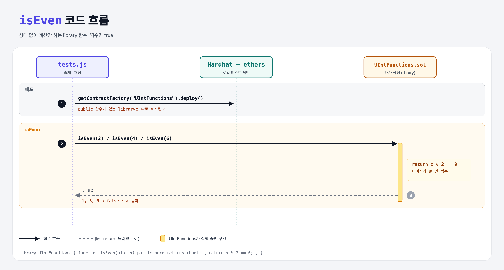

# UInt Library (Libraries 1단계)

## 문제

library `UIntFunctions`에 public pure 함수 `isEven(uint)`를 만든다. 짝수면 `true`.

## 한 줄 요약

`return x % 2 == 0;` — 상태 변수 없이 입력만으로 답을 내는 함수.



---

## 0. 이 과제가 말하려는 것

> **library = 상태(저장 변수)가 없는 "공용 함수 모음". 여러 컨트랙트가 같은 코드를 나눠 쓰려고 만든다.**

```
is-even → using → console-log → divides-evenly → is-prime → prime-game
```

| | contract | library |
|---|----------|---------|
| 상태 변수 | O | **X** (컴파일 에러) |
| 이더 받기 · 상속 | O | X |
| 목적 | 앱 로직 | 코드 공유 (예: OpenZeppelin `Math`, `Strings`) |

Python으로 치면 `utils.py` 모듈에 함수만 모아 둔 것.

---

## 1. 파일 구성

| 파일 | 역할 |
|------|------|
| `UIntFunctions.sol` | **이번에 완성할 library** |
| `tests.js` | 출제 · 채점 (테스트 2개) |

---

## 2. 정답 코드

```solidity
library UIntFunctions {
    function isEven(uint x) public pure returns (bool) {
        return x % 2 == 0;
    }
}
```

`pure`: 블록체인 상태를 읽지도 쓰지도 않는다. library 함수는 상태가 없으니 보통 `pure`나 `view`.

---

## 3. 테스트 한 줄씩

```js
const Library = await ethers.getContractFactory("UIntFunctions");
library = await Library.deploy();            // public 함수가 있는 library는 따로 배포할 수 있다
await library.callStatic.isEven(2);          // true
await library.callStatic.isEven(3);          // false
```

---

## 5. 실행 방법

```bash
sh tools/sol-test.sh week7/library-is-even
```

## 로컬 실행 환경 메모

강의 사이트는 브라우저 안에서 Hardhat으로 컴파일·테스트한다. 로컬에서는 루트의 Hardhat(ethers v5)으로 똑같이 돌린다: `sh tools/sol-test.sh <폴더>`.

## 기억할 것

1. library에는 상태 변수가 없다.
2. `%`는 나머지 (Python과 같음).
