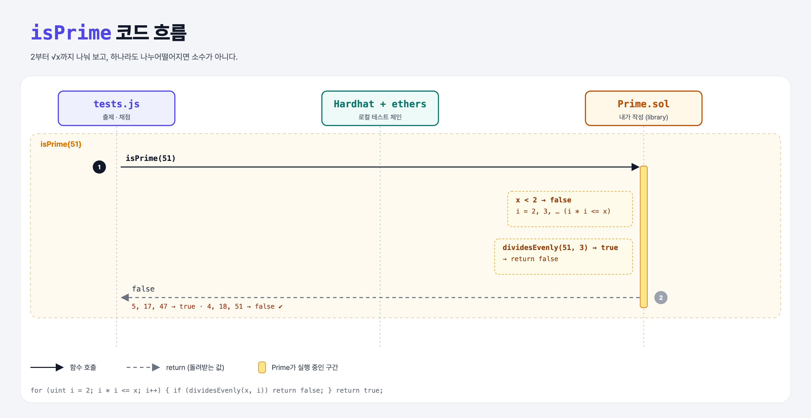

# Is Prime (Libraries 5단계)

## 문제

library `Prime`에 `isPrime(uint)`: 소수면 `true`.

## 한 줄 요약

2 미만은 false. 2부터 `i * i <= x`까지 `dividesEvenly(x, i)`가 하나라도 true면 false, 아니면 true.



---

## 0. 이 과제가 말하려는 것

> **같은 library 안의 함수는 이름만으로 바로 부를 수 있다.**

소수 판별은 √x까지만 나눠 보면 충분하다. 51 = 3 × 17이면 둘 중 작은 3이 반드시 √51(약 7.1) 이하에 있기 때문. Solidity에는 제곱근 함수가 없으니 `i * i <= x`로 같은 효과를 낸다.

```python
def is_prime(x):
    if x < 2: return False
    i = 2
    while i * i <= x:
        if x % i == 0: return False
        i += 1
    return True
```

---

## 1. 파일 구성

| 파일 | 역할 |
|------|------|
| `Prime.sol` | dividesEvenly + **isPrime** |
| `test.js` | 출제 · 채점 (테스트 2개) |

---

## 2. 정답 코드

```solidity
function isPrime(uint x) public pure returns (bool) {
    if (x < 2) {
        return false;
    }
    for (uint i = 2; i * i <= x; i++) {
        if (dividesEvenly(x, i)) {
            return false;
        }
    }
    return true;
}
```

반복을 줄이는 게 중요한 이유: 컨트랙트에서 실행하면 반복 한 번마다 가스가 든다.

---

## 3. 테스트 한 줄씩

```js
const primes = [5, 17, 47];       // → true
const nonPrimes = [4, 18, 51];    // → false
```

---

## 5. 실행 방법

```bash
sh tools/sol-test.sh week7/library-is-prime
```

## 로컬 실행 환경 메모

강의 사이트는 브라우저 안에서 Hardhat으로 컴파일·테스트한다. 로컬에서는 루트의 Hardhat(ethers v5)으로 똑같이 돌린다: `sh tools/sol-test.sh <폴더>`.

## 기억할 것

1. √x까지만 확인 → `i * i <= x`.
2. library 안에서는 다른 함수를 이름으로 바로 호출.
